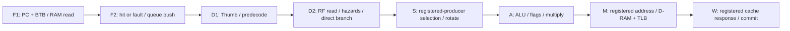

# ARM9V2: eight-stage redesign for 47 M instructions/s

Status: F1/F2, predictor, return stack and raw instruction queue implemented and
tested as a component. D1 through W and V2 instruction execution are not yet
implemented. `CORE="ARM9"` still selects the paused core; ZAP remains default.
The paused implementation and its measured limitations remain in [ARM9.md](ARM9.md)
and the [last report](consults/2026-10-23-codex-arm9-report.md). This is a new
pipeline, not another timing patch to its six-producer execute/address chain.

## Goal and gates

The acceptance result is at least **47 M architecturally retired instructions/s
in gameplay on the MiSTer**, with the whole device meeting **104 MHz**. This is
CPI <= 104/47 = 2.213; the working target is 2.2. Measure busy gameplay windows,
report idle time separately, and compare the same scenes and input sequence.
Asphalt's 21 frames/s, smooth Tony Hawk, and Sonic in the teens-to-twenties are
board outcomes, not conclusions drawn from synthetic CPU tests.

The suite and standalone fit are intermediate gates:

| Gate | Required evidence |
|---|---|
| Architectural | All existing QEMU references agree, instruction traces and signatures; retain ARM925T modes, CP15/MMU, alignment, faults, FIQ/IRQ and abort base restoration. The brief named 57 references; the merged checkout has more. Run every available reference, not a reduced set of 57. |
| Compiled throughput | At 0:0, ctrand1 <47,000 clocks and crand1 <47,500, with >=35% reduction against the same-revision ZAP. With ZAP 72,922, the 35% gate tightens crand1 to <=47,399. |
| Cache workload | cache <520,000 at 0:0; compare all three latencies against ZAP. |
| Breadth | Report cache, dcache_rtl, ctrand1, crand1, all random seeds, gba_arm, gba_thumb and mmu_page at 0:0 / 0:3 / 2:9, with instruction counts. |
| CPU timing | 104 MHz, seed 2/3/4, same RTL and constraints: median worst slow-corner setup slack >=−1 ns, positive hold slack. Record every seed, area, RAM, DSP and worst 30 paths. This permits integration; it is not timing closure. |
| Structural stop | If a completed structural pass is still below −2 ns, stop that shape and describe the remaining chains. Do not search seeds to conceal the failure. |
| Area | Compare against same-cache ZAP; retain the previous <=5% ALM allowance unless the lead changes it. Whole-device fit is authoritative. |
| Whole device | Only after the CPU timing gate: build ARM9V2 on the server, `BUILD_DIR=dev/mister/NGage_MiSTer-arm9v2 ./build.sh remote compile`, with `NGAGE_NO_DEBUG` uncommented in the build tree. Whole-core 104 MHz must actually close before board performance is accepted. |

Rare redirects may cost clocks to preserve timing. A systematic common-case
bubble is measured explicitly. The prior two-clock load-use restriction is
superseded by this redesign's **three-clock interlock**; the address must come
from a register. A correctly predicted branch should lose **zero fetch slots**,
not the paused core's one lost slot/two-clock branch spacing.

## Reuse and source boundaries

Reuse the project's GPL ARMv4T semantics, Thumb expansion, register file,
CP15/MMU, exception machinery, shared cache/TLB RAMs and Wishbone merger.
`arm925t` keeps its external ports, debug meanings and `CORE` selection. ZAP
remains default during development. The paused core is retained as a regression
reference; V2 modules live under `rtl/cpu/arm9v2/` with distinct names.

The other thread owns `rtl/cpu/zap/zap_dcache*.sv`: non-blocking store allocation
and write-back after fill arrive through the shared cache. This redesign does
not implement a competing cache FSM. Merge adaptations are documented separately
from V2 changes. Cache geometry, prefetch options and CP15's reported identity
remain configurable through the merged wrapper.

The [Antigravity consultation](consults/2026-10-23-antigravity-timing.md), ARM9
section, supplies structural constraints. The
[local Pocket review](consults/2026-10-23-plasticbugs-pocket-core.md) and
[upstream design discussion, sections 5.3–5.6](https://github.com/plasticbugs/n-gage/blob/main/docs/core-design.md#53-pipeline)
were read for ideas only. No unlicensed RTL is copied. Its reported eight-stage
results motivate splitting decode and execute; they do not establish timing
or CPI for our MMU, caches, device model or FPGA. Our implementation and tests
are written independently against ARMv4T and the repository's existing blocks.

## Stage contract

Every stage owns its valid record. Kills change validity and epochs, not wide
payload muxes. Stage registers are protected from retiming where moving a
control bit would reconnect a forwarding, address or admission chain.

| Stage | Work and boundary |
|---|---|
| F1 | PC is a register. The BTB synchronous read is launched on the edge that installs that PC, so its registered entry is usable during F1. Tag/state/return selection chooses the following launch; it never waits for D decode or a combinational backend commit. Cache RAM and TLB read the same launch address. |
| F2 | Cache compare/way selection and permission status terminate at queue push and fault/pending metadata. Enqueue a raw instruction word, PC/state, prediction and epoch. No response-to-D bypass and no Thumb decoder here. |
| D1 | One Thumb expander at the queue boundary. Predecode class, physical source/destination tags and instruction mode; compute LDM/STM population count, first register, next-list/last indicators and small offsets. PC-relative branch information is independent of operand forwarding. |
| D2 | Read the existing register file from registered tags in parallel with final control decode. Resolve unconditional direct branches from registered PC/immediate information. Compute/register predicted taken/fallthrough target matches for A; compare source tags against registered pending destinations to stall loads in D2. |
| S | One common forwarding selector, three registered producer records. One rotator implements LSL/LSR/ASR/ROR with parallel mask/fill/carry logic. Register-controlled shift captures the low-eight-bit amount before rotating. Multiplier stage one samples final operands at the S/A edge. |
| A | ALU, condition/flags, effective address, multiply completion. No barrel shifter in series. Result/address/control end in registers. Redirect event and target are registered, never gates on the whole backend's data. |
| M | A's address register drives D-TLB/cache RAM. Request, mode, alignment, byte enables, source and destination remain attached during a hold. No ALU-to-TLB combinational address path. |
| W | Consume the cache's registered compare/format output, architectural register writes, faults and trace retirement. Early critical-word/background replies are captured with their destination before becoming producers. |

The two cache edges occupy M and the input side of W. A hit load's formatted
value reaches a registered cache output at the end of its W lookup cycle;
S may then pick it up. This schedule must be demonstrated in edge-by-edge
bench traces, not inferred from stage names. A preceding load in S at cycle 0
is in A at 1, M at 2 and W lookup at 3; its immediate consumer enters S at 4.
That is three skipped issue opportunities, while independent accesses can
still launch on consecutive clocks.

## Flow control, forwarding and hazards

Do not recreate `M hit -> pipe_hold -> A free -> S free -> D2 issue -> F1 PC`.
Use registered downstream capacity with reserved storage for the one item
already in flight when backpressure arrives. D2/S has a skid slot; any other
registered-ready boundary needs equivalent reserved capacity. A cache ACK can
advance its local owner, but cannot select a new instruction or register-file
address through several stages in the same clock. Prove occupancy bounds and
stable requests under randomized holds.

The common operand network uses three **registered producer records**, newest
first, with primary/secondary destination lanes where the ISA requires two
writes. Three records does not mean only three physical destination tags.
There is no independent D forwarding tree and no duplicate held-S tree.
Held S captures its own selected operands, preventing a producer that retires
while S waits from disappearing. RF write-through handles a W write coincident
with a D2 read. Background load values join a registered producer/retirement
record rather than a fourth live cache input.

Precompute tag matches for the stage positions the instruction will encounter;
carry the match bits across the boundary and recompute while held. Producer
write-valid/condition-pass bits qualify them. A failed younger writer must not
hide an older load to the same register. Assertions compare these match bits
with direct tag comparisons on every transfer and hold.

An immediately preceding ALU operation has not produced a register at S's
entrance. Two cases are distinct:

- A source needed by the rotator or multiplier stalls in D2 until a registered
  producer is available. Do not forward an A adder through S's rotator.
- An unshifted operand needed only in A may carry a precomputed late-pickup
  token. A small, registered-control selection from M/W updates that operand
  before the ALU. This is not a second general tag-search network. Include it
  in the real timing trial. A failed producer falls back to the older matching
  producer or captured RF value; flags and condition results are preserved.

| Hazard | Planned action |
|---|---|
| Immediate hit-load consumer | Hold D2 for three clocks; S consumes registered formatted data. Base, store data and shift amount are tracked separately. |
| Load with independent intervening instructions | Subtract covered slots from the three-clock interlock; no blanket drain. |
| Shift amount from register | One additional capture clock, including zero amount; failed-condition instruction has no shift side effect. |
| Background load miss | Destination scoreboard stays locked until the registered return. Independent instructions may proceed only within precise-retirement constraints. |
| Store followed by lookup to the same set | Compare registered set/direction tags and hold the younger request through the RAM write collision window. No new combinational byte merge in M; a core-side interlock must make the old shared merge redundant before any request to remove it. |
| Multiply destination or accumulator dependency | Stall D2 until its registered producer is ready; independent older work drains normally. No whole-pipeline multiply barrier. |
| CP15, mode change, SPSR restore, SWP | Ordered fence where required. Drain fault-capable older memory records; restart with new mode/translation after commit. |
| IRQ/FIQ | Insert at an architectural instruction boundary, never inside an LDM/STM sequence or between inseparable internal uops. Preserve precise PC, mode and masks. |

Use an A-local flags register with ordered updates and restore on older fault
or CPSR write. Do not select flags through a multi-stage priority tree feeding
condition decode and then the entire pipeline's enables.

## Predictor and redirects

Default enabled; accuracy builds may disable prediction without changing ISA
behavior. Initial size: 256 direct-mapped entries, two-bit saturating direction
counters, source tag/state, target/state, branch kind. Reuse the project's
synchronous BTB RAM primitive; the paused `zap_btb` decision/state interface is
not reused blindly because its state and decision have different latency.

A lookup reads at the same edge that installs F1's PC. The address comes from
registered redirect candidates or the local F1 sequential/predicted choice,
never from an A/cache commit-qualified next-PC chain. If a candidate lookup
was speculative and its redirect did not commit, register that mismatch and
suppress its prediction. Misses, read/write collisions, clear during hold and
same-index aliases need directed tests. Invalidation clears valid state;
feedback is a registered record, and its RAM write lands on a later edge.

The eight-entry return stack predicts BX lr, POP/LDM with PC, and MOV pc,lr.
Only recognized calls push; predicted returns pop. Each prediction carries the
pre-action pointer/depth. A squash restores that checkpoint and applies the
resolving instruction's actual call/return action. Stack contents need not be
architecturally rolled back: overflow or overwritten speculative entries may
mis-predict, but all targets are validated before younger side effects commit.
Underflow must be defined, never an X. CP15/context changes may conservatively
clear both predictor and stack. Returns with SPSR/mode changes are ordered.

Redirect costs below are **lost fetch opportunities** after the redirecting
instruction, with a hot target and no outstanding miss. They are design targets,
not measured V2 results. The window tests also include their marker/consumer;
store that addition explicitly rather than conflating window deltas and stalls.

| Event | Resolve/apply boundary | Lost slots target |
|---|---|---:|
| Correct BTB or RAS target | F1 local choice, later validated | 0 |
| Unconditional direct B/BL, no correct prediction | D2 registered redirect | 3 |
| Thumb BL suffix paired with known prefix | D2 registered redirect; preserve both architectural records | 3 |
| Conditional B direction error, BX, SWI/undefined, MSR control restart | A registered decision | 5 |
| General ALU PC write / indirect target needing a registered comparison | M | 6 |
| Load to PC with target ready/validated in M | M, if the cache boundary actually provides it | 6 |
| Load to PC whose value/comparison completes at W | W | 7 |
| Correctly predicted load/ALU return | Verify at its real completion stage; hold younger side effects until verified | 0 refill slots; ordering stalls measured separately |
| Data abort / IRQ / FIQ / CP15 fence | Oldest safe architectural boundary | Source-stage cost plus explicit older-work drain; no fixed number assumed |

Our shared two-edge cache may force loads to PC to the W row. Do not promise
M resolution by borrowing the combinational cache hit into a backend clear.
PC-relative target addition and target-equality work finish in D, and A
conditional resolution selects registered match bits. Arbitrary BX/ALU/load
PC compares may take the later boundary. Every stale prediction on a
non-branch or condition-failed branch refetches its architectural fallthrough.
An early direct redirect is speculative with respect to older faults; those
faults win, and its fetched records cannot commit first.

## Instruction cycle model

Reference: ARM9TDMI DDI0180A chapter 7, tables 7-1/7-2. `n` is register count,
`m` is the TRM multiply early-termination count, `b` is coprocessor wait. V2 is
ARMv4T-compatible, not cycle-identical to the five-stage ARM9TDMI. Steady-state
issue cost is listed separately from dependency/redirect penalties.

| Class | ARM9TDMI | V2 design target, hot memory |
|---|---|---|
| Independent DP / MRS / flags-only MSR | 1 | 1; no global drain for ordinary flags operations |
| DP with register-specified shift | 2 | 2; one amount-capture clock |
| Condition-failed ordinary instruction | 1 | 1; no destination, flags or memory side effect |
| DP to PC | 3, or 4 with register shift | 1 issue + M redirect cost; a validated return prediction suppresses refill |
| Independent LDR/STR | 1 | 1 issue/clock with separate memory records and available hit capacity |
| Immediate LDR consumer | 2 total, or 3 for byte/half/unaligned | 1 load issue + 3 interlock slots; registered format removes a live formatter from S |
| LDR PC | 5 | 1 + M/W redirect cost, or validated RAS path; any retirement barrier reported |
| LDM/STM | 2 for n=1, n for n>1 | one register/clock; n+1 or n+2 total issue occupancy, no nine-clock setup/drain |
| LDM including PC | n+4 | ordinary transfer occupancy plus final PC/exception-return ordering cost |
| SWP/SWPB | 2 / 3 with byte consumer | ordered read/store uops with one architectural retirement; cache/bus waits explicit |
| B/BL/BX | 3 | correct prediction: 1 issue, zero lost fetch slots; otherwise redirect table |
| SWI/undefined | 3 | ordered exception plus A redirect target; younger stores cancelled |
| MCR/MRC | b+1, consumer b+2, PC b+3 | retain CP15 handshake; ordered mode/cache operations; count actual busy and drain clocks |
| Unsupported CDP/LDC/STC | coprocessor-dependent | undefined trap under existing ARM925T rules |
| MUL/MLA | 2+m | two-stage DSP pipeline starting at S/A, completion in A with bounded extra hold; exact early-out policy and measured windows fixed at that milestone |
| SMULL/UMULL/SMLAL/UMLAL | 3+m | same multiply pipeline plus ordered high-word/accumulate work; preserve both writes and flags |
| Thumb | corresponding ARM operation | one expansion in D1; BL halves retain architectural trace semantics |

LDM offsets/count/next-register are D1 registers. D2 sequences an already
classified block with 8-bit signed byte offsets, rather than recomputing a
16-bit scan through banking and RF selection. IA/IB/DA/DB, writeback/base in
list, user-bank access, PC/SPSR and base-restored aborts must pass existing
QEMU tests before throughput is claimed. Empty-list behavior follows the
existing undefined policy unless a separate architectural change is requested.

## Milestones and verification

1. Merge master and regenerate; establish ZAP counts, all available references,
   and paused ARM9 compatibility. Keep any pipeline-specific test exclusion
   explicit: its blocking-load design cannot satisfy `dhum_rtl`'s required
   overlap counters. V2's final gate includes that test.
2. Commit this design before V2 RTL. Build the real front end and predictor,
   with directed cycle checks for one fetch/clock, zero-slot trained branches,
   aliases, clear/hold/retry, epoch kills and RAS repair. An isolated front-end
   fit is component evidence only, never an integrated CPU timing claim.
3. D1/D2 with one Thumb expander and streamed blocks; S/A with the actual
   three-producer network, late pickup, single rotator and DSP multiplier;
   M/W with registered addresses and precise fault ordering. Commit each
   working milestone and label incomplete instruction/cycle coverage.
4. Every integrated milestone: regenerate, lint, suite at three latencies,
   QEMU diff, directed window checks, cycle table and CPU-alone fit. Do not
   retarget a failed model silently; record the architectural cost decision.
5. At a complete structural-pass fit below −2 ns, stop and report. Once within
   range, measure the same revision at seeds 2/3/4. At most two of this task's
   Quartus containers, four globally; inspect Docker before launching.
6. Only after the median CPU gate, perform the specified whole-core build.
   Board validation follows a timing-clean bitstream. No firmware boot bench
   is part of this task. Do not modify `sys/` or push branches.

Each session ends at a clean commit with
`docs/consults/2026-10-2N-codex-arm9v2-sN.md`: implemented scope, exact counts,
fit corners/seed/area, functional and timing risks, missing coverage, and the
next concrete boundary. An incomplete component has no whole-workload CPI
claim. This document is updated with measured values as milestones land.

## Session 1 measured front end

`arm9v2_fetch` holds F1/F2 metadata with the short-read I-cache and enqueues raw
words in eight register entries. Cache ACK/error/retry affect queue insertion
and status; they do not select the queue's instruction data or decode controls.
The queue has no empty bypass. Redirects kill queued epochs and drain an older
untagged cache transaction before reusing its request slot. Early-return words
remain pending until the fill's final fault status arrives.

`arm9v2_predict` reads a 256 x 60-bit full-tag/state/target/counter/kind record
using the existing synchronous RAM primitive. F1's source PC and RAM read land
on the same edge. Its decision chooses the following lookup without discarding
F2. The eight-entry RAS supplies a return target, carries pre-action pointer and
depth in each packet, and repairs them from a registered backend event. Return
opcode classification and architectural prediction validation await D/A/M/W.

The RAM's new `HOLD_READ=1` option retains its collision bypass during a disabled
read: otherwise a write-first entry disappears on the next held clock. Existing
callers retain the default behavior. Source and generated component tests cover
the collision, later writes to the same index, all 256 indices, Thumb source
state, saturation, clear, RAS wrap/underflow and repair. Fetch checks cover
queue backpressure, retry, held-miss redirects, epoch wrap and late fill faults.
A real 16 KB two-way short-read I-cache/TLB bench verifies raw word/PC alignment,
translated faults, uncached fetch and a hot three-target BTB loop at one word
per clock with bus waits of 0, 3 and 9 clocks. Run all with
`make -C sim/cpu arm9v2-frontend`.

The following are **component fits**, excluding both caches and D1 through W.
They use Quartus 17.0.2, 5CSEBA6U23I7 and the normal 9.615 ns trial constraint.
The wrapper registers stimulus and outputs; the ten-word declared stimulus
shift chain is trimmed to its used bits. No multicycle exceptions were added.

| Seed | Slow 100C ns | Slow -40C ns | Minimum hold ns | ALMs | M10Ks |
|---|---:|---:|---:|---:|---:|
| 2 | -0.203 | -0.574 | +0.127 | 1,090 | 2 |
| 3 | -0.459 | -0.856 | +0.127 | 1,084 | 2 |
| 4 | -0.611 | -0.895 | +0.117 | 1,085 | 2 |

Median worst slow-corner slack is **-0.856 ns**. This meets the numerical range
for this component, **not the CPU integration gate**. Seed 2's worst path is
BTB RAM output -> full-tag match -> predicted/sequential launch select -> next
lookup's 256-entry valid selection -> `read_valid`, seven logic levels and
7.909 ns data delay with -2.110 ns clock skew. Adding a decode admission or
cache-hit qualifier to that loop would spend an already small timing margin.
Seed 2's hierarchical area estimate assigns 526.3 ALMs to predictor/RAS/RAM
collision logic, 484.0 to the rest of fetch/queue and 79.7 to the trial wrapper;
rounding and cross-entity packing apply.

The [session report](consults/2026-10-23-codex-arm9v2-s1.md) records unchanged
ZAP/paused-ARM9 cycles, full regression results, retained fit reports, limitations
and the next milestone: D1/D2. No V2 CPU throughput or whole-device result exists
at this stopping point.
