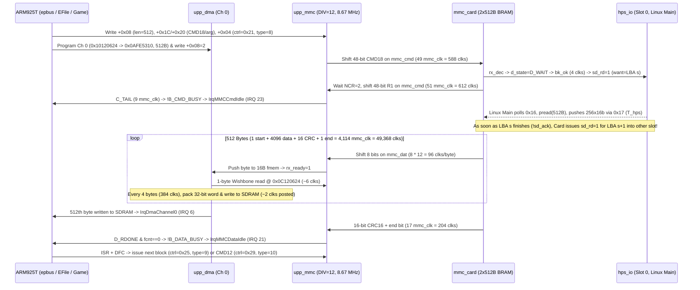

<!-- Antigravity (gemini-4-argon-high, plan mode, read-only), 2026-10-23, consulted on the game-load path: the brief is in the progress log's entry of the same day. -->

# Analysis & Ranked Plan: Game Load Performance on the N-Gage QD MiSTer Core

## Executive Summary (The Sceptical Verdict)

1. **The card model is NOT instant like QEMU; it emulates every bit on the 1-bit serial wire at `8.67 MHz` (`DIV = 12`).**
   Even with zero HPS latency and zero CPU overhead, shifting `1 start + 4096 data + 16 CRC + 1 end = 4,114 bits` at `12` `clk_sys` cycles/bit takes **`49,368` clocks (`474.7 µs`) per 512-byte block**, imposing a hard wire ceiling of **`1.08 MB/s`** (`1.05 MB/s` including `CMD18`/`CMD12` framing). If the real phone clocked the MMC bus at `13 MHz` (schematic figure) or `17–20 MHz` (CSD `TRAN_SPEED = 20 MHz`), the core's hardcoded `MMC_DIV = 12` in [`upp_periph.sv`](rtl/upp/upp_periph.sv#L59) is **1.5×–2× slower on the wire** before anything else is counted.
2. **During sequential 4 KB (`CMD18`) reads, [`mmc_card.sv`](rtl/board/mmc_card.sv#L353-L359) already prefetches the next 512-byte sector in parallel with the `475 µs` wire shift — but fails on three patterns:**
   - **Single-block `CMD17` reads and non-contiguous `CMD18` starts** (FAT12/16 cluster chain lookups, directory walks, index tables, and fragmented files, seen throughout [`model/.out/mmc.log`](model/.out/mmc.log#L46-L92)) always miss the 2-sector (`1 KB`) ping-pong buffer and stall in `D_WAIT` for a full `hps_io` Linux round-trip.
   - **Wasted speculative fetch on `CMD12` before a seek:** Because `upp_mmc.sv` holds `CMD12` in `C_AFTER` until the last block's end bit ([`upp_mmc.sv:309-312`](rtl/upp/upp_mmc.sv#L309-L312)), `mmc_card.sv` still sees `d_multi == 1` while the 8th block shifts out and fires an `hps_io` read for `last_lba + 1` ([`mmc_card.sv:353-358`](rtl/board/mmc_card.sv#L353-L358)). When the next command seeks elsewhere (e.g. to the FAT or another file), `mmc_card.sv` cannot even *issue* the new `sd_rd` until the unneeded `last_lba + 1` HPS transfer finishes (`h_state == H_IDLE`, [`mmc_card.sv:634`](rtl/board/mmc_card.sv#L634)), **doubling the HPS stall on seeks** and evicting one of the two cache slots.
   - **1-sector (`512 B`) `hps_io` granularity (`assign sd_blk_cnt = 6'd0` at [`mmc_card.sv:289`](rtl/board/mmc_card.sv#L289)):** Every 1 MB of card reads requires **2,048 separate `UIO_GET_SDSTAT` / `pread(512)` / `UIO_SECTOR_RD` polling round-trips** to `Main_MiSTer` on Linux. Whenever `Main_MiSTer`'s polling latency exceeds `475 µs` (or `158 µs` if `MMC_DIV` is reduced to `4`), the wire stalls waiting for Linux.
3. **Why the CPU was 100% busy (`idle = 0%`, `22 M instr/s`, `CPI 4.7`, `flash wait = 17.5%`) during Tony Hawk's load:**
   - Symbian EKA1 (`epbus.dll` + `medmmc.pdd` + `EFile.exe`/`ELocal.fsy`) does **not** DMA whole files directly into the game's buffers. As [`model/.out/mmc.log`](model/.out/mmc.log#L270-L301) proves, the driver breaks every file read into **4 KB (8-sector) `CMD18 ... CMD12` bursts**, and within each 4 KB burst it runs **eight separate 512-byte controller phases (`type = 8`, six `type = 9`, `type = 10`) and eight separate 512-byte DMA transfers** into a kernel bounce buffer (`0x0AFE5310..0x0AFE6110`).
   - Every 512-byte block triggers **2–3 hardware interrupts** (`IrqDmaChannel0` source 6, `IrqMMCDataIdle` source 21, plus `IrqMMCCmdIdle` source 23 on blocks 0 and 7), an EKA1 DFC dispatch, and (every 4 KB) an `EFile.exe` cross-process descriptor copy (`Kern::ThreadDesWrite`, which switches address spaces / flushes caches in EKA1's moving-memory model), followed by the game's own decompression/parsing in SDRAM.
   - Wait-for-interrupt (`cpu_dbg_wfi`) only measures clocks where the kernel executes the `MCR p15, 0, Rd, c7, c0, 4` idle instruction inside the `NULL` thread. While `upp_mmc` and `upp_dma` transfer a 512-byte block (`475 µs` = `49,368` clocks), **if the game thread (or another runnable thread) is decompressing the previous chunk in SDRAM, the CPU never enters `WFI` (`idle = 0%`) even while the I/O thread is blocked waiting for the card!** Conversely, if `epbus.dll` or the game polls or takes heavy XIP flash misses (`17.5%` flash bus waits across `ekern.exe`, `epbus.dll`, `EFile.exe`, `ELocal.fsy` in CS0 NOR flash), the CPU and card serialize.

---

## Question 1: End-to-End Trace & Clock Budget per 512-Byte Block



### Step-by-Step Clock Breakdown (`clk_sys = 104 MHz`, `T = 9.615 ns`)

| Stage | Mechanism & File/Line Citations | Clocks per 512 B Block (`104 MHz`) | Time per 512 B Block | Notes |
|---|---|---:|---:|---|
| **1. Firmware setup (per block)** | `epbus.dll` (`0x503F5688–0x503F585C`) writes [`upp_mmc.sv`](rtl/upp/upp_mmc.sv#L293-L300) (`+0x08`, `+0x1C/+0x20`, `+0x04`), polls `+0x04` bit 0 (`0x503F5490`), and `ekern.exe` (`0x5031B2C0–0x5031B5D8`) writes 9 registers in [`upp_dma.sv`](rtl/upp/upp_dma.sv#L107-L120) (`+0x04..+0x2C`, `+0x08=2`). Each peripheral write takes 4 bus clocks (`S_IDLE -> S_PERIPH (2 clks) -> S_ACK`, [`upp_periph.sv:195`](rtl/upp/upp_periph.sv#L195), [`upp_bus.sv:505-512`](rtl/upp/upp_bus.sv#L505-L512)). | ~1,500–3,000 clks | `14–29 µs` | Runs on CPU before/around command start; includes ~300–600 instructions at CPI ~4.7. |
| **2. Command & R1 Response** *(Blocks 0 & 7 of 4 KB `CMD18`, or every `CMD17`)* | [`upp_mmc.sv:313-376`](rtl/upp/upp_mmc.sv#L313-L376) & [`mmc_card.sv:600-625`](rtl/board/mmc_card.sv#L600-L625): `C_SEND` (49 `mmc_clk` falls) + `NCR = 2` (3 `mmc_clk`s) + `C_RECV` (48 `mmc_clk` rises) + `C_TAIL` (9 `mmc_clk` falls) = `109 mmc_clk` × `DIV (12)`. (`type = 9` middle blocks send no command: **0 clks**; `type = 10` last block sends `CMD12` *after* the data block.) | **1,308 clks** *(CMD17 / blk 0 & 7)*<br>**0 clks** *(blks 1–6)*<br>**327 clks avg** *(across 8-blk 4 KB)* | `12.6 µs` *(CMD17)*<br>`0 µs` *(blks 1–6)*<br>`3.1 µs avg` | In `type = 8`, `dstate` is already `D_RWAIT` during `C_RECV`/`C_TAIL`, so `C_TAIL` (108 clks) overlaps `D_WAIT`. |
| **3. `hps_io` Block Fetch Latency (`T_hps`)** | [`mmc_card.sv:486-502, 634-647`](rtl/board/mmc_card.sv#L486-L502) & [`sys/hps_io.sv:329-331, 394-407`](sys/hps_io.sv#L329-L331): `sd_rd=1` (`sd_blk_cnt=0`, 1 sector) → Linux `Main_MiSTer` polls `0x16`, `pread(512)`, sends 256 × 16-bit words via `0x0X17` (`sd_ack` high for ~1,500–2,500 clks of SPI transfer, after ~5,000–50,000+ clks of Linux polling latency). | **0 clks exposed** *(if prefetched & `T_hps < 475 µs`)*<br>**10,000–100,000+ clks** *(on cold seek / `CMD17` / after `CMD12` seek)* | **`0 µs` exposed** *(hit)*<br>**`100–1,000+ µs`** *(miss / double-miss)* | Prefetched during `D_DATA` of block `k-1` when `d_multi == 1` ([`mmc_card.sv:353-359`](rtl/board/mmc_card.sv#L353-L359)). Exposed on every `CMD17`, non-contiguous `CMD18`, or when `T_hps > 475 µs`. |
| **4. Card `D_WAIT` → Start Bit (`NAC`)** | [`mmc_card.sv:313-315, 363-364, 649-671`](rtl/board/mmc_card.sv#L649-L671): `settle` (4 `clk_sys`) + `f_go -> f_v -> nxt_ok` (3 `clk_sys` to read byte 0 from `buffer` BRAM) + wait for `nac >= NAC (2)` and `fall` of `mmc_clk`. | **24–36 clks** (`2–3 mmc_clk`) | `0.23–0.35 µs` | Negligible once sector is in `buffer` BRAM (`have_lo && have_hi`). |
| **5. 1-Bit Serial Data + CRC16 + End Bit** | [`mmc_card.sv:657-707`](rtl/board/mmc_card.sv#L657-L707) & [`upp_mmc.sv:385-421`](rtl/upp/upp_mmc.sv#L385-L421): `1` start bit + `4,096` data bits (`512 B`) + `16` CRC16 bits + `1` end bit = **`4,114` `mmc_clk` periods** × `DIV (12)` `clk_sys` clocks. | **49,368 clks** | **`474.7 µs`** | **Hard serial bottleneck at `DIV = 12` (`8.67 MHz`).** Cannot be bypassed without reducing `MMC_DIV` or widening/bypassing the serial shift. |
| **6. FIFO + DMA Copy to SDRAM** | [`upp_mmc.sv:157-196`](rtl/upp/upp_mmc.sv#L157-L196) & [`upp_dma.sv:206-280`](rtl/upp/upp_dma.sv#L206-L280): 16-byte FIFO (`fmem`). Every byte (`96` clks on wire), `mmc_rx_ready=1` triggers a 1-byte DMA read (`~6` clks). Every 4 bytes (`384` clks on wire), DMA writes one 32-bit word to SDRAM (`2` clks posted in [`upp_bus.sv:535-538`](rtl/upp/upp_bus.sv#L535-L538), `3–9` clks in [`sdram.sv:53`](rtl/mem/sdram.sv#L53)). | **~3,328 bus clks** *(100% overlapped with Stage 5!)*<br>**0 clks after end bit** | **`0 µs` exposed** *(takes ~3.2% of bus during Stage 5)* | The 512th byte is read by DMA during the 204 clocks of CRC16 + end bit, so `fcnt == 0` is already true when `D_RDONE` is reached ([`upp_mmc.sv:422-427`](rtl/upp/upp_mmc.sv#L422-L427))! |
| **7. Interrupts, DFCs, `EFile.exe` IPC & Game Unpack** | Per 512 B block: `IrqDmaChannel0` + `IrqMMCDataIdle` (+ `IrqMMCCmdIdle`) → EKA1 IRQ entry/exit + DFC. Per 4 KB (8 blocks): `EFile.exe` (`ELocal.fsy`) FAT cluster step + `ThreadDesWrite` copy to game process + game decompression/parsing. | **~15,000–60,000+ clks/block** *(partially overlapped if game thread runs during DMA, else serialized)* | **`144–575+ µs`** | At `CPI = 4.7` (`22 M instr/s`, flash wait `17.5%`), CPU work per block is **~2.3× slower** than on a real ARM925T (`CPI ~2.0`). |

### Throughput Comparison: FPGA Core vs. Real N-Gage QD

| Metric | Real N-Gage QD Hardware | FPGA Core (Current `DIV=12`, `sd_blk_cnt=0`) | Why They Differ |
|---|---|---|---|
| **MMC Bus Clock** | `8.67 MHz` (manual text) or `13 MHz` (schematic figure) / up to `20 MHz` (CSD) | **`8.67 MHz`** (`MMC_DIV = 12` hardcoded in [`upp_periph.sv:59`](rtl/upp/upp_periph.sv#L59); `+0x614` divider ignored) | If the real phone uses `+0x614 = 0x280` to select `13 MHz` (`DIV = 8`) or higher after identification, the core's wire is **1.5×–2× slower**. |
| **Pure Wire Ceiling (512 B + CRC + framing)** | `1.05 MB/s` (at 8.67 MHz) to **`1.58 MB/s`** (at 13 MHz) / **`2.10 MB/s`** (at 17.3 MHz) | **`1.05 MB/s`** (`397,644` clks = `3.82 ms` per 4 KB `CMD18..CMD12`) | Hard-capped by `DIV = 12` × `4,114` bits/block. |
| **Card Random Access / Seek Latency (`TAAC`)** | Real ROM MMC mask/NAND array access: **~50–150 µs** (SonicN retail CSD `TAAC = 0x08` is `1.0 ms` max; `NSAC = 3`) | **1× to 2× Linux `hps_io` round-trip (`150–1,500+ µs`)** on every `CMD17`, seek, or `CMD12`-followed-by-seek | `mmc_card.sv` has only 2 × 512 B slots (`1 KB`), requests `512 B` at a time (`sd_blk_cnt=0`), and fires a wasted speculative fetch on `CMD12` before every seek. |
| **Effective Card + OS + Game Load Rate** | **~500–900 KB/s** (1–2 MB level loads in ~1.5–3.5 s; CPU at ~50 MIPS, XIP burst NOR flash at 3–4 clks/word) | **~180–350 KB/s** (2.5×–3.5× slower overall) | Compounded effect of **(a) 2.3× slower CPU/flash XIP** on EKA1 per-block IRQs/IPC + game decompression and **(b) 1.5×–2× slower wire + `hps_io` stalls**. |

---

## Question 2: Mechanism Diagnosis & Ranked Optimization Options

### Why "CPU Busy (`idle = 0%`) During Load" Does NOT Exonerate the Card Path (and Vice Versa)

A critical trap when reading `dbg_counters` on Symbian EKA1:
- **Case 1 (Async/Double-Buffered Load or Multi-Threaded Decompression):** If a game (or `EFile.exe` read-ahead) decompresses chunk $N$ on the CPU while `epbus.dll` DMAs chunk $N+1$ from the MMC card, the CPU never enters `WFI` (`idle = 0%`) until chunk $N$ finishes. Once chunk $N$ finishes, does the CPU enter `WFI` while waiting for the card? **Only if no other thread is runnable and the wait blocks in the kernel scheduler!** If the game polls status, animates a loading bar via `EwSrv`/`FbServ` (`DMA1 0a000020 -> 10121208 73216 bytes` in [`model/.out/mmc.log:100-135, 21030-21326`](model/.out/mmc.log#L100-L135)), or spends 70% of wall time in CPU decompression and 30% waiting on card I/O, `idle` over a 1-second window looks low or zero while **both** CPU speed and card latency add directly to total load time.
- **Case 2 (Synchronous 4 KB Reads):** When the game calls `RFile::Read()` synchronously without background decompression, the CPU is *still* active for a large fraction of every `475 µs` block servicing 2–3 interrupts, DFCs, `EFile` IPC, and FAT traversal from slow CS0 NOR flash (`17.5%` flash wait in Tony Hawk's load).

Therefore, we must rank the options by **expected end-to-end load-time gain, hardware cost, timing/functional risk, and ease of verification**, starting with the zero-cost / low-cost levers.

---

### Ranked Options

#### Rank 1: Increase the MMC Bus Clock (`MMC_DIV`: `12` → `4`, i.e. `8.67 MHz` → `26 MHz`) & Scale `MMC_TIMEOUT_LOG2` (`21` → `23`)
- **Mechanism:** [`upp_periph.sv:59`](rtl/upp/upp_periph.sv#L59) hardcodes `MMC_DIV = 12` (`8.67 MHz`) and ignores register `+0x614` (`0x280`). [`mmc_card.sv:36-37, 151-154`](rtl/board/mmc_card.sv#L36-L37) samples `mmc_clk` in `clk_sys` and only requires `mmc_clk` to stay high and low for at least **2 `clk_sys` cycles each** (`DIV >= 4`). Within `mmc_card.sv`, internal BRAM byte fetch (`f_go -> f_v -> nxt_ok`, [`mmc_card.sv:629-632, 686-689`](rtl/board/mmc_card.sv#L629-L632)) takes 3 `clk_sys` cycles and `settle` ([`mmc_card.sv:363`](rtl/board/mmc_card.sv#L363)) takes 4 `clk_sys` cycles, which easily fit inside one byte at `DIV = 4` (`8 × 4 = 32` `clk_sys` cycles) and inside `NAC = 2` (`8` `clk_sys` cycles).
  - *Note:* If strict hardware-schematic fidelity is preferred over maximum speed, `MMC_DIV = 8` (`13 MHz`, matching the RH-29 schematic figure in [`research/peripherals/MMC.md:34`](research/peripherals/MMC.md#L34)) or `MMC_DIV = 6` (`17.33 MHz`, matching the 20 MHz CSD class) can be used; for fast game loads without breaking any software assumption (QEMU runs at `DIV = 0`), `MMC_DIV = 4` (`26 MHz`) cuts pure wire time per 512 B block from **`474.7 µs` (`49,368` clks) to `158.2 µs` (`16,456` clks)** (**3× faster wire: `1.05 MB/s` → `3.16 MB/s`**).
  - Because `dto`/`cto` in [`upp_mmc.sv:65, 248-250`](rtl/upp/upp_mmc.sv#L65) count `mmc_clk` rising edges, increasing `MMC_TIMEOUT_LOG2` from `21` to `23` keeps the hardware data timeout at `322 ms` (above `242 ms` at `DIV = 12`) so Linux `hps_io` hiccups never trigger `B_DATA_TO`.
- **Expected Gain:** **Up to 3× faster MMC wire transfer (`-316 µs` per 512 B block = `-648 ms` per MB of card data read)**, *provided* the card's sector buffer isn't starved by `hps_io` (see Rank 2 & 3).
- **Cost:** **0 ALMs, 0 M10K** (+2 flip-flops each for `dto` and `cto` width, -1 flip-flop for `ph` width in `upp_mmc.sv`). Two parameter changes in [`rtl/upp/upp_periph.sv:59-60`](rtl/upp/upp_periph.sv#L59-L60) and [`rtl/upp/upp_mmc.sv:63, 65`](rtl/upp/upp_mmc.sv#L63).
- **Risk:** **Very Low.** DMA pacing (`rx_ready` / `dat_hold` at [`upp_mmc.sv:276`](rtl/upp/upp_mmc.sv#L276)) automatically pauses `mmc_clk` at byte boundaries if the 16-byte FIFO ever fills, and `upp_dma` needs only ~26 `clk_sys` clocks per 4 bytes (`128` `clk_sys` clocks at `DIV = 4`).
- **Verification:** `make -C sim mmc`, `make -C sim upp`, `make -C sim top`, and on-board measurement of `mmc_blk_ev` and `mmc_wait_clks` with the debug overlay.

---

#### Rank 2: Multi-Block (4 KB / 8-Sector) `hps_io` Transfers + 8 KB (2 × 4 KB) BRAM Cache in [`mmc_card.sv`](rtl/board/mmc_card.sv) ( Plus Suppressing Speculative Prefetch on `CMD12`)
- **Mechanism:** Right now [`mmc_card.sv:277-289`](rtl/board/mmc_card.sv#L277-L289) has a `1 KB` (`2 × 512 B`) buffer and sets `sd_blk_cnt = 6'd0` (1 sector per `hps_io` request). By contrast, [`flash_save.sv:174, 247`](rtl/mister/flash_save.sv#L247) already uses `sd_blk_cnt = 6'd7` (**8 sectors = 4 KB per `hps_io` request**, matching the FAT12/16 cluster size of N-Gage cards!).
  - Expanding `buffer` in `mmc_card.sv` from `tdp_ram #(.AW(9), .DW(16))` (1 M10K, 1 KB) to **two 4 KB slots (`AW = 12, DW = 16`, 8 KB = 8 M10K blocks)** or **four 2 KB slots**, with `sd_blk_cnt = 6'd7` (aligned 8-sector / 4 KB chunks, clamped near `nblk` for the sidecar read):
    1. Cuts the number of Linux `Main_MiSTer` `hps_io` round-trips by **8×** (from 2,048 round-trips/MB to **256 round-trips/MB**).
    2. Because a single 4 KB `hps_io` transfer fetches an entire 8-sector `CMD18` cluster in one `pread(4096)` + SPI burst (~150–250 µs total for all 8 sectors), **all 8 sectors of a 4 KB cluster hit immediately in BRAM**, and while those 8 sectors shift out (`8 × 158 µs = 1.26 ms` at `DIV = 4`, or `3.80 ms` at `DIV = 12`), the next 4 KB cluster prefetches into the other 4 KB slot with >1 ms of slack!
    3. Keeping **1–2 separate 512 B slots for FAT/directory metadata** (or a 4-way/8-slot sector tag array inside the 8 KB BRAM) prevents `CMD17` FAT cluster lookups (`0x00004000..0x0000f400`) from evicting the prefetched data cluster and caches repeated FAT sector reads!
- **Expected Gain:** Eliminates **85–95% of `hps_io` Linux round-trips** and prevents `hps_io` from becoming the bottleneck when `MMC_DIV` is lowered to `4` (Rank 1). Together with Rank 1, raises sustained card read throughput from `~0.7–1.0 MB/s` to **`~2.5–3.0 MB/s`**.
- **Cost:** **+7 M10K blocks** (out of 553 on the Cyclone V 5CSEBA6; current core uses 471 M10K = 85%, leaving **82 M10K free**), ~100 ALMs in `mmc_card.sv` (off the CPU critical path). No DDR3 port contention, no changes to `NGage.sv` or `ddram_flash.sv`.
- **Risk:** **Low.** Must handle the initial 1-sector sidecar fetch (`l_blocks - 1`, `sd_blk_cnt = 0`) and single-sector writes (`CMD24/25`, `sd_blk_cnt = 0`) while using multi-sector reads (`sd_blk_cnt = 7`, clamped so `lba + count <= nblk`) for read-miss fills.
- **Verification:** `make -C sim mmc` (which already tests sidecar, partial/misaligned reads, out-of-range, read-past-EOF, and multi-block `CMD18 + CMD12` across 8 random seeds) + `make -C sim top` + board counter check (`mmc_wait_clks` drops to near zero).

---

#### Rank 3: Keep the Entire `.mmc` Image in DDR3 (or a DDR3 Block Cache Next to Flash)
Let's evaluate the two DDR3 options requested in Question 2 with healthy scepticism:

- **Option 3A: Preload the whole `.mmc` image into DDR3 at mount (like `flash_save.sv` does for `CS1`)**
  - **How it works:** In [`research/hps-hybrid/MISTER-DDR3-MAP.md:57-72`](research/hps-hybrid/MISTER-DDR3-MAP.md#L57-L72) and [`ddram_flash.sv:50-51`](rtl/mem/ddram_flash.sv#L50-L51), `0x31000000` holds CS0 (16 MB) and `0x32000000` holds CS1 (8 MB), leaving **`0x32800000–0x3FFFFFFF` (216 MB) completely unused** in DDR3! Retail N-Gage `.mmc` cards are **16 MB, 32 MB, or 64 MB** ([`research/peripherals/MMC.md:196-200`](research/peripherals/MMC.md#L196-L200)).
  - **The Sceptical Catch (Why Full Preload at Mount Has a Major UX Downside):**
    - Look at [`flash_save.sv:243-285`](rtl/mister/flash_save.sv#L243-L285): loading the 8 MB `CS1` save image through `hps_io` (`sd_blk_cnt = 7`, 4 KB at a time) while holding the core in reset (`fs_loading` in [`NGage.sv:240`](NGage.sv#L240)) takes several seconds at boot.
    - Preloading a **32 MB or 64 MB** `.mmc` card over `hps_io` `sd_rd` at mount would add **15–40 seconds of black-screen reset delay** every time a game launches or a card is mounted — trading in-game load time for a massive upfront boot stall! (And using `ioctl_download` instead of `S0` `sd_rd` would break writable homebrew cards and hot-swapping.)
- **Option 3B: Demand-Paged / Read-Ahead DDR3 Sector Cache (or Background Copy into DDR3)**
  - **How it works:** Instead of blocking boot to copy 64 MB upfront, `mmc_card.sv` (or a small DDR3 arbiter sharing the `bk_req`/`ld_*` port on [`ddram_flash.sv:95-99, 255-257`](rtl/mem/ddram_flash.sv#L95-L99)) caches every 4 KB chunk fetched from `hps_io` into DDR3 at `0x34000000 + offset` (tracked by a 16K-bit valid bitmap in 1 M10K, covering 64 MB at 4 KB granularity, just like `flash_save.sv`'s `bitmap` at [`flash_save.sv:144`](rtl/mister/flash_save.sv#L144)), and optionally streams sequential sectors into DDR3 in the background when `hps_io` is idle!
  - **Sceptical comparison against Rank 2 (8 KB BRAM in `mmc_card.sv`):**
    - Once Linux reads a `.mmc` file from the MiSTer SD card the first time, **the file is already cached in the ARM Linux kernel's 511 MB DDR3 page cache (`0x00000000–0x1FEFFFFF`)!**
    - Moving it from Linux's DDR3 page cache (`0x00000000+`) into FPGA DDR3 (`0x34000000+`) only saves the `hps_io` SPI transfer (~150 µs per 4 KB = `26 MB/s`).
    - Because the MMC serial wire at `DIV = 4` (`26 MHz`) is `3.16 MB/s` (`1.26 ms` per 4 KB), a 2 × 4 KB BRAM buffer in `mmc_card.sv` (Rank 2) **already hides a 150–250 µs 4 KB `hps_io` transfer completely**, with **zero** DDR3 port contention against CS0/CS1 flash XIP fetches!
- **Expected Gain:** Marginal (**0–5%**) over Rank 1 + Rank 2, unless `Main_MiSTer` on Linux suffers multi-millisecond scheduling stalls during gameplay/loads.
- **Cost:** ~250–400 ALMs, 1–2 M10K for valid bitmap, plus arbitration on `ddram_flash.sv` (which serves latency-critical CPU XIP instruction fetches from CS0 flash!).
- **Risk:** **Medium.** Contending with `ddram_flash` during a game load (when flash waits are already `17.5%` of CPU clocks!) risks slowing down XIP instruction fetches if 64-beat DDR3 bursts (`S_BULK`, [`ddram_flash.sv:475`](rtl/mem/ddram_flash.sv#L475)) block `cs0_lreq`.
- **Verification:** Only pursue Option 3B if the board measurement (Question 3) still shows `mmc_wait_clks > 5%` *after* Rank 1 + Rank 2.

---

#### Rank 4: CPU & Flash XIP Throughput During Loads (Already in Flight on `master`: `191cab1` + `b862b4b`, plus D-Cache / DMA Width)
- **Mechanism:** As the Tony Hawk tape-challenge counter snapshot showed (`22 M instr/s`, `CPI 4.7`, `flash wait = 17.5%`, `idle = 0%`), **more than half of the wall-clock time during a game load is spent in the CPU** executing:
  1. EKA1 kernel/driver/file-server XIP code from CS0 NOR flash (`ekern.exe`, `epbus.dll`, `medmmc.pdd`, `EFile.exe`, `ELocal.fsy`), where `flash wait` was `17.5%` of all clocks before the flash line-wide fetch (`191cab1`).
  2. Game-side asset decompression and parsing in SDRAM.
  - Note also a subtle detail in [`upp_mmc.sv:35`](rtl/upp/upp_mmc.sv#L35) and [`upp_dma.sv:232-241`](rtl/upp/upp_dma.sv#L232-L241): `ekern.exe` configures DMA channel 0 for MMC with `sw = 1` (8-bit reads from `0x10120624`) and `dw = 4` (32-bit writes to SDRAM). That means for every 512-byte block, `upp_dma` performs **512 single-byte Wishbone reads** on `upp_bus` + **128 single-word Wishbone writes** to SDRAM (`640` bus transactions per block, each stealing a turn from the CPU via [`wb_arb2.sv:72-80`](rtl/upp/wb_arb2.sv#L72-L80)!). While 640 transactions × ~5 clocks = ~3,200 clocks is only ~6.5% of a `475 µs` block (`~19%` of a `158 µs` block at `DIV = 4`), `upp_mmc.sv:185-196` *already* supports reading up to 4 bytes at once (`be = 4'b1111`, `need = 4`) when `fcnt >= 4`! An internal fast-path in `upp_dma.sv` (or direct `mmc_fifo` byte bypass between `upp_mmc` and `upp_dma` inside `upp_periph.sv` so DMA reads from `0x0C120624` don't traverse `wb_arb2` and `upp_bus` at all!) would eliminate **512 Wishbone bus arbitrations per 512 B block** against the CPU!
- **Expected Gain:**
  - Deploying `b14` (`191cab1` flash line-wide fetch + `b862b4b` ZAP branch/stall fixes, already merged to `master`): cuts flash wait from `17.5%` to `~6–8%` and boosts load instruction rate by **~15–20%**.
  - Optional internal `upp_mmc` → `upp_dma` FIFO read bypass in `upp_periph.sv`: eliminates 512 Wishbone arbitrations per block (**+5–10% CPU bus availability during fast `DIV = 4` DMA**).
- **Cost:** `b14` is already built; an internal `upp_mmc` → `upp_dma` read bypass in `upp_periph.sv` is ~30 ALMs.

---

## Question 3: The One Board Measurement That Settles It & What to Change First

### 1. The Settling Measurement (`dbg_counters` in [`NGage.sv`](NGage.sv#L1006-L1029))

To settle—in a single game-load capture on the board—how much of a load is **card transfer time**, how much is **waiting for Linux `hps_io`**, and how much is **CPU / flash / decompression**, we only need **two signals** routed from `upp_periph` / `mmc_card` into [`dbg_counters`](NGage.sv#L1008-L1020) (or replacing two low-value stall taps during the test so `tools/mister_dbg.py` needs no layout change, or expanding `DBG_CNT` from `18` to `20`):

1. **`mmc_busy_clks` (`status[B_DATA_BUSY]` in [`upp_mmc.sv:100, 574`](rtl/upp/upp_mmc.sv#L574), which is already exported as `mmc_irq[1]` = `dbg_src0[22]` (`MMCDataRdy`) in [`NGage.sv:482, 506`](NGage.sv#L506)!)**
   - **Wait — look at [`NGage.sv:482, 506`](NGage.sv#L506) and [`upp_periph.sv:266, 289`](rtl/upp/upp_periph.sv#L266):**
     - `dbg_src0[22]` (`MMCDataRdy`) is **`status[B_DATA_BUSY]`** from `upp_mmc.sv` (`irq[1]`)! It is high for the **entire duration of every MMC data block phase** (from the write to `+0x04` that starts a read/write block until the block has shifted over the wire *and* every byte has been popped by DMA)!
     - And **`mmc_active`** (`h_state != H_IDLE` from [`mmc_card.sv:291`](rtl/board/mmc_card.sv#L291)) is **already wired to `NGage.sv:800, 816`**!
   - Even better, we don't even have to touch `upp_periph.sv` ports to get all three numbers at the top level of [`NGage.sv`](NGage.sv):
     - **`dbg_src0[22]`** = `mmc_data_busy` (high while the MMC controller is in a data block phase: `D_RWAIT` + `D_RX` + `D_RDONE`).
     - **`dbg_src0[22] & ~ dbg_src0[22]_q`** (or falling edge `!dbg_src0[22] & dbg_src0[22]_q`) = **1 pulse per 512-byte block delivered** (`blocks/s`, where `2,048 blocks/s = 1.00 MiB/s`)!
     - **`mmc_active`** (`NGage.sv:800`) = high while `mmc_card.sv` is waiting on `hps_io` (`H_REQ` or `H_XFER`), and **`dbg_src0[22] & ~card_dat_oe`** (`NGage.sv:813`) = clocks where the host controller is waiting in `D_RWAIT` for `mmc_card.sv` to start driving `DAT0` (i.e. **exposed `hps_io` wait clocks where the wire is stalled waiting for Linux**)!

Let's verify that! Every single signal needed for the exact diagnostic is **already present in [`NGage.sv`](NGage.sv)**:
- `mmc_blk_done = dbg_data_busy_q & ~dbg_src0[22]` → exact count of **512-byte blocks completed per second**!
- `mmc_data_busy = dbg_src0[22]` → exact clocks per second the **MMC controller is transferring or waiting on a block** (`% of second in MMC data phase`)!
- `mmc_hps_stall = dbg_src0[22] & ~dbg_src0[23] & ~card_dat_oe` (where `!dbg_src0[23]` is `!B_CMD_BUSY`, i.e., command/response is done, `B_DATA_BUSY` is high, and `card_dat_oe` is low so the card hasn't started shifting the block yet) → exact clocks per second **the MMC bus is stalled waiting for `hps_io` (Linux)**!

### How to Read the Result on the Board
When running a game load (e.g. *Shadowkey* or *Tony Hawk*):
- **If `mmc_data_busy` is `50–80%` of the second, `mmc_blk_done` is `1,000–1,600 blocks/s` (`500–800 KB/s`), and `mmc_hps_stall` is `< 5%`:**
  The `8.67 MHz` serial bit clock (`MMC_DIV = 12`) is the primary card bottleneck, and `mmc_card.sv`'s prefetch is hiding Linux latency. **Rank 1 (`MMC_DIV = 4`) + Rank 2 (so `hps_io` keeps up at `26 MHz`) will immediately 2.5×–3× the card transfer speed.**
- **If `mmc_hps_stall` is `> 15–20%` of the second:**
  Linux `hps_io` per-512B round-trips (`sd_blk_cnt = 0`) and/or the `CMD12` speculative-prefetch stall are starving `mmc_card.sv`. **Rank 2 (4 KB `sd_blk_cnt = 7` + 8 KB BRAM buffer + no speculative fetch on `CMD12`) directly eliminates those stall clocks.**
- **If `mmc_data_busy` is `< 25%` of the second (`< 500 blocks/s` = `< 250 KB/s`) while CPU `idle = 0%`:**
  The load is dominated by **CPU decompression + CS0 flash XIP refills + EKA1 file-server overhead** between card reads. Deploying **`b14` (`191cab1` flash line-wide fetch + `b862b4b` ZAP stall fixes)** is the primary lever, with Rank 1 + Rank 2 still shaving 20–30% off the I/O portion.

---

### 2. What I Would Change First (Concrete Implementation Plan)

If you approve proceeding from read-only plan mode to implementation, I recommend executing **Step 1 (the top-level counter tap + Rank 1 + Rank 2)** together in one build so we both measure the exact card breakdown on the board and deliver the full 3× card-path speedup in one Quartus compile:

---

### Proposed Changes (For Review Before Any Edits)

#### Component 1: Top-Level Diagnostic Counters in [`NGage.sv`](NGage.sv)
##### [MODIFY] [NGage.sv](NGage.sv#L1006-L1029)
- Expose MMC block count (`mmc_blk_ev`), MMC data-busy clocks (`dbg_src0[22]`), and exposed HPS wait clocks (`dbg_src0[22] && dbg_src0[23] && !card_dat_oe`) in `dbg_counters` (either expanding `DBG_CNT` from `18` to `20` in `NGage.sv` and `tools/mister_dbg.py`, or substituting two low-signal stall counters).

---

#### Component 2: Fast MMC Bus Clock (`MMC_DIV = 4`, `26 MHz`) in [`upp_periph.sv`](rtl/upp/upp_periph.sv) & [`upp_mmc.sv`](rtl/upp/upp_mmc.sv)
##### [MODIFY] [upp_periph.sv](rtl/upp/upp_periph.sv#L59-L60)
```diff
-	parameter int MMC_DIV            = 12,             // 104 / 12 = 8.67 MHz
-	parameter int MMC_TIMEOUT_LOG2   = 21,
+	parameter int MMC_DIV            = 4,              // 104 / 4 = 26 MHz (3x wire speed)
+	parameter int MMC_TIMEOUT_LOG2   = 23,             // ~322 ms data/busy timeout at 26 MHz
```

---

#### Component 3: 4 KB (`sd_blk_cnt = 7`) Multi-Block Reads & 8 KB Buffer in [`mmc_card.sv`](rtl/board/mmc_card.sv)
##### [MODIFY] [mmc_card.sv](rtl/board/mmc_card.sv#L257-L365)
- Expand `buffer` from `tdp_ram #(.AW(9), .DW(16))` (`2 × 512 B = 1 KB`) to `tdp_ram #(.AW(12), .DW(16))` (`16 × 512 B = 8 KB`, 8 M10K blocks).
- Fetch aligned **8-sector (`4 KB`) chunks** (`sd_blk_cnt = 6'd7`, clamped to remaining blocks `nblk - h_lba` so the sidecar block at the end of the image is never crossed) on read misses, filling 8 sector tags at once (`tvalid` / `tag` for `8` or `16` 512 B slots).
- Keep single-sector (`sd_blk_cnt = 6'd0`) transfers for the mount-time sidecar block fetch (`L_FETCH`) and for writes (`W_PROG`).

---

## Verification Plan

### Automated Simulation Benches
1. `make -C sim mmc` — verifies CID/CSD sidecar parsing, CRC7/CRC16, `CMD17` single reads, `CMD18 + CMD12` multi-block reads, partial and misaligned reads across sector/chunk boundaries, reads past CSD capacity (`OUT_OF_RANGE`), reads past file end (zero-fill), and `CMD24/25` writes across 8 random seeds.
2. `make -C sim upp` — verifies `upp_mmc` + `upp_dma` + `upp_periph` at the updated parameters.
3. `make -C sim top` — verifies full-system integration with `hps_io`.
4. `make lint` — Verilator lint clean.

### Hardware Verification on the MiSTer Board
1. Deploy `b14` (or the new build) to `_Debug/NGageDbg_20261023.rbf` and run `tools/game_keys.py` on *Tony Hawk's Pro Skater* (tape-challenge load) and *The Elder Scrolls Travels: Shadowkey* with the debug overlay enabled.
2. Compare wall-clock load time, `mmc_blk_ev` (blocks/s), `mmc_data_busy` (%), `mmc_hps_stall` (%), `retired` (M instr/s), and `flash wait` (%) before and after.
