# Antigravity (Gemini 4 Argon, high effort) on 104 MHz closure of both cores, 2026-10-23

Consulted read-only on the ARM9 core (codex/arm9 worktree) and the ZAP tree (master) with the path reports; the brief is in the session's scratch area (agy-arm9-brief.md). Links were rewritten from the worktree paths to repository paths.

# 104 MHz Timing-Closure Consultation: ARM9 (5-Stage) vs. ZAP (12-Stage)

> [!IMPORTANT]
> **Target**: 104 MHz (`9.615 ns` clock period) at `Slow 1100mV 100C` and `Slow 1100mV -40C` on Cyclone V (`5CSEBA6U23I7`, Quartus Prime Lite 17.0.2), with ~2.5 CPI in gameplay on the board.
> - **ZAP (`CORE="ZAP"`)**: Whole-core slack is **-1.088 ns** (`10.703 ns` arrival vs `9.615 ns` required, 30 failing endpoints in [critical-paths.rpt](build/critical-paths.rpt#L51-L90)), running at 3.7 CPI on the board today (`15,917 ALMs` in CPU trial).
> - **ARM9 (`CORE="ARM9"`)**: Integrated CPU-only trial is **-8.332 ns** in Session 6b ([detail_Slow_1100mV_100C_Model.txt](docs/consults/arm9/session6b-arm9-fit-seed2/detail_Slow_1100mV_100C_Model.txt#L1-L58)) and **-7.532 ns** after registering the backend clear in Session 6c-(a) ([detail_Slow_1100mV_100C_Model.txt](docs/consults/arm9/session6c-a-fit-seed2/detail_Slow_1100mV_100C_Model.txt#L1-L58)), at `16,755–17,078 ALMs`, even though its isolated execute datapath ([arm9_execute_trial.sv](sim/cpu/quartus/arm9_execute_trial.sv#L1-L138)) closes at **+0.018 ns**.

---

## 1. ARM9 (`rtl/cpu/arm9`): Control Structure Required to Close 104 MHz

### Why `arm9_execute_trial` Closes (+0.018 ns) While `arm9_core` Fails (-8.33 ns / -7.53 ns)

Comparing [arm9_execute_trial.sv](sim/cpu/quartus/arm9_execute_trial.sv#L86-L136) against [arm9_core.sv](rtl/cpu/arm9/arm9_core.sv#L186-L1110) exposes why the isolated execute trial is a false positive:
1. In [arm9_execute_trial.sv](sim/cpu/quartus/arm9_execute_trial.sv#L103-L114), the pipeline advance signal (`advance`) is a **single flip-flop**, `PRODUCERS = 3` are **pure registers**, `i_flags` is a **4-bit flip-flop (`flags_q`)**, `i_pc8` and `i_branch_offset` are **pure flip-flops**, `branch_out` is **registered**, and D-stage register reads have **zero decode or forwarding logic** in front of or behind `zap_register_file`.
2. In [arm9_core.sv](rtl/cpu/arm9/arm9_core.sv), **six global combinational control/data loops** cross stage boundaries in the same clock cycle, and **zero `(* dont_retime *)` attributes** protect stage registers from Quartus `PHYSICAL_SYNTHESIS_REGISTER_RETIMING ON` ([cpu_trial.qsf](sim/cpu/quartus/cpu_trial.qsf#L22)).

### Required 5-Stage Pipeline Architecture & Stage Boundaries

```mermaid
flowchart LR
    subgraph F1["F1: RAM / TLB Read"]
        PC["pc_q (FF)"] --> ICRAM["I-Cache Tag/Data RAM + I-TLB RAM"]
        PC --> BTB["zap_btb"]
    end
    subgraph F2["F2: Hit/Thumb Latch"]
        ICRAM --> F2REG["early_packet (FF)\n+ hit_q / fault_q (FF)"]
    end
    subgraph D["D: Decode + RF Read + PC Branch Adder"]
        F2REG --> Q["Fetch Queue (FF)"]
        Q --> DEC["Decode + RF Read\n+ PC-Rel Branch Adder"]
        DEC --> DEREG["(* dont_retime *)\nD/E Operand & Control FFs\n+ e_hazard_wait_q (FF)"]
    end
    subgraph E["E: Forward (3-Prod) + Shift + ALU"]
        DEREG --> EX["arm9_forward (M1, M2, W)\n-> Shift -> ALU\n-> cond_pass"]
        EX --> EMREG["(* dont_retime *)\nE/M1 Pipe FFs (fast_1)\n+ br_redirect_q (FF)\n+ flags_e_q (FF)"]
    end
    subgraph M1["M1: D-RAM / D-TLB Read"]
        EMREG --> DCRAM["D-Cache Tag/Data RAM + D-TLB RAM"]
        DCRAM --> M1M2["(* dont_retime *)\nM1/M2 Pipe FFs (fast_m)\n+ tr_cache_* (FF)"]
    end
    subgraph M2W["M2/W: Format + Commit"]
        M1M2 --> WB["Load Format + RF Write (fast_w)"]
    end
```



To close `9.615 ns` (~8–9 Cyclone V ALM levels max per stage), the five stages must obey five hard structural rules:

#### Rule 1: `(* dont_retime *)` Stage-Boundary Lockdown & Single E-Stage Forwarding Network (`PRODUCERS = 3`)
- **Rule**: Only **one** forwarding network may exist in the core: `u_execute.u_forward` at the start of E, with at most **3 registered producers** (`fast_1` ALU result, `fast_m` ALU/load result, `fast_w` writeback result). All D/E and E/M/W stage registers (`value_e`, `tag_e`, `used_e`, `op_e`, `fast_1`, `fast_m`, `fast_w`) must carry `(* dont_retime *)`.
- **What must be eliminated**:
  1. **Delete `u_decode_forward` in D** ([arm9_core.sv](rtl/cpu/arm9/arm9_core.sv#L504-L509)) and **delete `u_held_forward` in E** ([arm9_core.sv](rtl/cpu/arm9/arm9_core.sv#L512-L516)). Currently, `value_e` is updated by `u_held_forward` on every E clock (`if (e_valid) value_e <= held_value` at [arm9_core.sv](rtl/cpu/arm9/arm9_core.sv#L815)) while `u_execute.u_forward` ([arm9_execute.sv](rtl/cpu/arm9/arm9_execute.sv#L48-L55)) simultaneously forwards into the same `value_e`! When an instruction stalls in E for 1 cycle, `u_execute.u_forward` can capture the forwarded value into `value_e` using `u_execute`'s own forwarded operand vector (`ex_operand`), removing `u_held_forward` completely (`-350 ALMs`, removes the `u_held_forward` duplicate register cloud that dominates Session 6c-(a) at `-7.532 ns` in [detail_Slow_1100mV_100C_Model.txt](docs/consults/arm9/session6c-a-fit-seed2/detail_Slow_1100mV_100C_Model.txt#L18-L49)).
  2. **Precompute scoreboard hazard stalls in D from tag comparisons only (`e_hazard_wait_q`)**, never from inside `arm9_forward` during E:
     - Producer readiness (`write_ready[0..5]`) must **not** be evaluated combinationally inside `u_execute.u_forward` to drive `execute_wait` -> `execute_fast` -> `issue` / `early_redirect`.
     - Instead, compare `tag_d[0..3]` against `dest_e` (when `e_is_load || e_is_mul || e_is_cp15`), `m1_load_dest`, and `i_dc_lock` in D. If an instruction in D reads a register being loaded by E (load-use hazard), stall it in **D** for 1 cycle (`d_load_hazard`), rather than issuing it into E and stalling E via `execute_wait`!
  3. **Register D-cache M2 load data (`m2_load_data_q`, `m2_load_valid_q`) and background load return (`bg_data_q`, `bg_tag_q`) before forwarding**:
     - Producer 2 (`write_value[2] = i_data_wb_dat`, `write_ready[2] = i_data_wb_ack && !i_dcache_err2` at [arm9_core.sv](rtl/cpu/arm9/arm9_core.sv#L199-L203)) injects the D-cache FSM and M2 hit logic directly into the 6-input forwarding mux in E.
     - Producer 0 (`write_value[0]` at [arm9_core.sv](rtl/cpu/arm9/arm9_core.sv#L213-L228)) priority-muxes `fast_1` and `m_valid` before entering `arm9_forward`.

#### Rule 2: What the Branch Decision May and May Not Touch Combinationally
- **What it MAY touch in E**:
  - A dedicated `flags_e_q` flip-flop (updated at the E/M1 boundary, never a 4-stage priority mux across `fast_1`, `fast_m`, `fast_w`, `wb_cpsr`) -> `condition_pass` (2 LUT levels) + ALU `Z/N/C/V` flags -> a single registered redirect flip-flop `br_redirect_q` and `br_target_q`.
- **What it MAY NOT touch combinationally**:
  1. **Never put `arm9_forward` in front of the branch target adder**:
     - At [arm9_core.sv](rtl/cpu/arm9/arm9_core.sv#L235), `branch_base = kind_e == K_BL_SUFFIX ? held_value[0] : pc8;` feeds `u_execute.i_pc8` ([arm9_core.sv](rtl/cpu/arm9/arm9_core.sv#L492)), which feeds the 32-bit adder `o_branch_target = i_pc8 + i_branch_offset` ([arm9_execute.sv](rtl/cpu/arm9/arm9_execute.sv#L102)).
     - For `K_BRANCH` and `K_BL_PREFIX` (all PC-relative branches), `pc8 + branch_offset` depends only on D-stage fields (`d_pc8` and immediate offset) and **must be computed in D** and registered into `branch_target_e_q`!
     - For Thumb `K_BL_SUFFIX`, the prefix instruction in the immediately preceding cycle already computed `LR = d_pc8 + (offset << 12)`; registering that prefix sum in a dedicated `bl_prefix_target_q` FF allows `K_BL_SUFFIX` to add `bl_prefix_target_q + (imm11 << 1)` in D (unless `LR` was explicitly written by a non-prefix instruction), removing `held_value[0]` from the branch adder entirely.
  2. **Never put a 32-bit target comparator *after* the E-stage adder**:
     - At [arm9_core.sv](rtl/cpu/arm9/arm9_core.sv#L237-L240), `resolved_next` muxes `branch_target` vs `pc + (2 or 4)` and then runs a 32-bit `e_pred_target != resolved_next` comparator (`Equal1` in [detail_Slow_1100mV_100C_Model.txt](docs/consults/arm9/session6b-arm9-fit-seed2/detail_Slow_1100mV_100C_Model.txt#L38)).
     - Because `branch_target_d = d_pc8 + branch_offset_d` and `fallthrough_d = d_pc + (thumb ? 2 : 4)` are both known in D, the two 32-bit comparisons (`pred_matches_taken_e_q <= (d_pred_target == branch_target_d)` and `pred_matches_nt_e_q <= (d_pred_target == fallthrough_d)`) **must be computed in D and registered into E as 2 single-bit flip-flops**!
     - Then in E, `prediction_wrong` for `K_BRANCH` / `K_BL_SUFFIX` is a **1-LUT function** of `ex_pass`:
       `prediction_wrong = ex_pass ? (!e_predicted || !pred_matches_taken_e_q) : (e_predicted && !pred_matches_nt_e_q);`
  3. **Never drive `arm9_fetch` (`i_redirect`, `i_target`, `o_valid`, `queue[tail]`, `epoch`) or D-stage `issue` combinationally from E's branch resolution or ALU output**:
     - Even in Session 6c-(a) where `clear_e_late` / `clear_pipe_late` were added for the backend, `early_redirect` ([arm9_core.sv](rtl/cpu/arm9/arm9_core.sv#L566)) still combinationally drives `f_redirect` ([arm9_core.sv](rtl/cpu/arm9/arm9_core.sv#L717)) and `f_target` ([arm9_core.sv](rtl/cpu/arm9/arm9_core.sv#L733-L734)), which enters [arm9_fetch.sv](rtl/cpu/arm9/arm9_fetch.sv#L130-L204) to gate `request`, `response`, `push`, `epoch <= epoch + 1`, and `pc_q <= i_target`.
     - For `K_BX` or ALU-to-PC (`ex_pc_write`), `early_target` is `ex_result` (the output of the 32-bit barrel shifter + 32-bit ALU carry chain in E!). Sending `ex_result` combinationally through `f_target` -> `map_pc` -> `arm9_fetch` -> `o_pc_nxt` is impossible at 104 MHz.
     - **Requirement**: Register `early_redirect` and `early_target` at the E/M1 clock edge (`redirect_m1_q`, `target_m1_q`), alongside `clear_e_late`. In the cycle E resolves a mispredict, E's clock enable is unaffected, and at the rising edge of M1:
       - D and E are squashed (`clear_d_q`, `clear_e_q` or epoch tag mismatch), and
       - `pc_q` in `arm9_fetch` loads `target_m1_q`.

#### Rule 3: What Fetch Validity (`i_instr_hit` / `i_instr_wb_ack` / `tlb_fault`) May and May Not Touch Combinationally
- **What it MAY touch in F2**:
  - Only the **write enable (`push`) and valid/fault status bits of the fetch queue (`queue[tail]`)** in `arm9_fetch` (or an F2 skid register).
- **What it MAY NOT touch combinationally**:
  1. **No combinational bypass from F2 (`incoming` / `i_hit` / `i_ack`) to `o_valid` / `o_instruction` into D**:
     - In Session 6b/6c-(a), `o_valid = count != 0 || push` and `head_packet = count != 0 ? queue[head] : incoming` sent `u_code_cache|u_zap_tlb|u_zap_tlb_check|o_fsr[2]` -> `tlb_fault` -> `o_hit` -> `u_fetch|o_instruction` -> `kind_d` -> `read_tag` -> `u_decode_forward` -> `issue` -> `u_execute|u_forward` (16 levels, `17.214 ns` in [detail_Slow_1100mV_-40C_Model.txt](docs/consults/arm9/session6b-arm9-fit-seed2/detail_Slow_1100mV_-40C_Model.txt#L18-L55)).
     - The working tree edit at [arm9_fetch.sv](rtl/cpu/arm9/arm9_fetch.sv#L142-L143) (`assign head_packet = queue[head]; assign o_valid = count != 0 && !queue[head].pending && queue[head].epoch == epoch;`) rightly cuts the F2->D bypass, **but** [arm9_fetch.sv](rtl/cpu/arm9/arm9_fetch.sv#L109-L116) still muxes `selected_packet` (108 bits wide) using `!i_hit` (which comes from `zap_tlb_check` -> `tlb_fault` -> `ic_hit` at [zap_cache.sv](rtl/cpu/zap/zap_cache.sv#L295-L296)) and `u_thumb` (combinational Thumb decoder on `i_data` at [arm9_fetch.sv](rtl/cpu/arm9/arm9_fetch.sv#L63-L73)) directly into the 8-entry x 108-bit register array `queue[tail]` ([arm9_fetch.sv](rtl/cpu/arm9/arm9_fetch.sv#L181))!
  2. **Move Thumb expansion (`zap_mode16_decoder`) out of F1/F2 and into the Queue-to-D boundary (or store raw 32-bit/16-bit words in `queue`)**:
     - Currently [arm9_fetch.sv](rtl/cpu/arm9/arm9_fetch.sv#L63-L92) instantiates **two** full copies of `zap_mode16_decoder` (`u_thumb` and `u_thumb_early`), placing `u_thumb_early` in F1 right after the I-cache M10K data RAM output and way mux (`o_data_early = raw_cache_word_sel ? ...` at [zap_cache.sv](rtl/cpu/zap/zap_cache.sv#L294)), and `u_thumb` in F2 on the slow `i_data` path!
     - Storing the **raw 32-bit instruction word** in `queue` (reducing `fetch_packet_t` width from 108 bits to ~72 bits) and running **one** `zap_mode16_decoder` on `queue[head]` (or registering the expanded D-stage instruction `d_ins_q` between Queue head and D) removes `zap_mode16_decoder` from both the M10K read path (F1) and the `i_hit` mux path (F2).

#### Rule 4: D-Stage Decode & Register File Read Must Not Include 16-Bit Priority Scan + 6-Producer Forwarding + Barrel Rotate
- In [arm9_core.sv](rtl/cpu/arm9/arm9_core.sv#L361-L469), D-stage combinational logic currently serializes:
  1. `transfer_reg_d` ([arm9_core.sv](rtl/cpu/arm9/arm9_core.sv#L394-L397)): a 16-iteration sequential loop with a priority check and popcount (`transfer_count_d = transfer_count_d + 5'd1`) on `d_ins[15:0]` to find the first register of an `LDM`/`STM`,
  2. `read_tag[0..3]` ([arm9_core.sv](rtl/cpu/arm9/arm9_core.sv#L398-L412)): muxing `transfer_reg_d` into architectural register indices and passing through 4 copies of `translate(..., d_cpsr_mode)`,
  3. `u_wb.u_zap_register_file` ([arm9_core.sv](rtl/cpu/arm9/arm9_core.sv#L984-L993)): 4 ports of 40:1 32-bit register file read muxes,
  4. `u_decode_forward` ([arm9_core.sv](rtl/cpu/arm9/arm9_core.sv#L504-L509)): 4 ports of 6-producer 32-bit forwarding muxes,
  5. `rotate_right({24'd0, d_ins[7:0]}, {d_ins[11:8], 1'b0})` ([arm9_core.sv](rtl/cpu/arm9/arm9_core.sv#L431)): 32-bit immediate rotation and `d_pc8 + 32'd4` adder ([arm9_core.sv](rtl/cpu/arm9/arm9_core.sv#L426)).
- **Fix**:
  - Precompute the first-set-bit index (`first_reg_d`) and single-register indicator (`single_reg_d = (d_ins[15:0] & (d_ins[15:0] - 16'd1)) == 16'd0`) when pushing into `queue` (or at the Queue->D latch), and maintain `transfer_list_q` as a registered bitmask that clears its lowest set bit (`transfer_list_q & (transfer_list_q - 16'd1)`), eliminating the 16-step `for` loop and adder at [arm9_core.sv](rtl/cpu/arm9/arm9_core.sv#L394-L397).
  - Remove `u_decode_forward` ([arm9_core.sv](rtl/cpu/arm9/arm9_core.sv#L504-L509)); let `value_e` capture the raw RF output `read_value[0..3]` (or immediate), and let `u_execute.u_forward` handle all forwarding in E (with an RF write-through bypass for W->D same-cycle reads).

#### Rule 5: Decouple D-Cache `SHORT_READ` Store-to-Load Merge & Combinational `pipe_hold`
- Look at [zap_dcache.sv](rtl/cpu/zap/zap_dcache.sv#L365-L406) (`SHORT_READ = 1`):
  - `forward_store` and `forward_victim` ([zap_dcache.sv](rtl/cpu/zap/zap_dcache.sv#L366-L369)) depend on `cf_cache_tag_wr_en` and `cf_cache_line_ben` from `zap_dcache_fsm` (which is already the #1 critical path in ZAP!) AND `raw_cache_tag == cf_cache_tag`, then byte-merge 128-bit `merged_line` and 64-bit `merged_words`, and **then** run `ld_transform` ([zap_dcache.sv](rtl/cpu/zap/zap_dcache.sv#L390-L392), byte/halfword rotation + sign extension) **all in M1 before the `tr_cache_words` register**!
  - And in M2, `i_data_wb_ack` and `i_dcache_err2` combinationally drive `pipe_hold` ([arm9_core.sv](rtl/cpu/arm9/arm9_core.sv#L543-L546)), which stalls `fast_w`, `fast_m`, `fast_1`, `execute_fast`, and `issue` ([arm9_core.sv](rtl/cpu/arm9/arm9_core.sv#L553-L570,L686))!
- **Fix**:
  - Move `ld_transform` out of M1 ([zap_dcache.sv](rtl/cpu/zap/zap_dcache.sv#L390-L392)) into M2 on the registered `tr_cache_words` (just like ZAP does in `zap_dcache_fsm`), and instead of a 128-bit combinational store-to-load merge in M1, stall a load in D for 1 cycle if `m1_is_store` (or `e_is_store`) is active (`1-bit interlock`), so `zap_ram_simple`'s built-in registered write-forwarding pipeline handles it cleanly.

### Summary of Violations in `rtl/cpu/arm9` & Unavoidable Cycle Costs

| Violation in `rtl/cpu/arm9` | Exact File & Line Citations | Structural Fix | Unavoidable Cycle Cost |
| :--- | :--- | :--- | :--- |
| **V1**: Missing `(* dont_retime *)` on stage registers; triple 6-producer forwarding (`u_decode_forward`, `u_held_forward`, `u_execute.u_forward`) | [arm9_core.sv](rtl/cpu/arm9/arm9_core.sv#L66-L108), [L475-L516](rtl/cpu/arm9/arm9_core.sv#L475-L516), [L815](rtl/cpu/arm9/arm9_core.sv#L815); [arm9_execute.sv](rtl/cpu/arm9/arm9_execute.sv#L48-L55) | Add `(* dont_retime *)` on `value_e`, `tag_e`, `used_e`, `fast_1`, `fast_m`, `fast_w`; remove `u_decode_forward` & `u_held_forward`; reduce `u_execute.u_forward` to 3 registered producers (M1, M2, W). | **0 cycles** on ALU/shift; **0 cycles** on 2-cycle load-use (stall in D instead of E). |
| **V2**: Forwarded operand `held_value[0]` into E branch adder -> `resolved_next` -> 32-bit `!=` -> combinational `early_redirect` / `f_redirect` / `f_target` | [arm9_core.sv](rtl/cpu/arm9/arm9_core.sv#L235-L240), [L492](rtl/cpu/arm9/arm9_core.sv#L492), [L566](rtl/cpu/arm9/arm9_core.sv#L566), [L717-L735](rtl/cpu/arm9/arm9_core.sv#L717-L735); [arm9_execute.sv](rtl/cpu/arm9/arm9_execute.sv#L102) | Compute PC-relative branch target & `pred_matches_*` in D; register `br_redirect_q` and `br_target_q` at the E/M1 edge. | **0 cycles** on predicted branches (still 2 clocks); **+1 cycle** on mispredicted branches (5 -> 6 clocks, or 7 with F2 queue boundary). |
| **V3**: Combinational 4-stage `execute_flags` priority mux into `u_execute.i_flags` | [arm9_core.sv](rtl/cpu/arm9/arm9_core.sv#L517-L521), [L474](rtl/cpu/arm9/arm9_core.sv#L474) | Maintain a single dedicated `flags_e_q` register updated at the E/M1 boundary (reloaded from `wb_cpsr` on `wb_redirect`). | **0 cycles**. |
| **V4**: Combinational `execute_wait` & `pipe_hold` driving `execute_fast` -> `issue` -> `f_ready` -> `arm9_fetch` `pop` & E clock enables | [arm9_core.sv](rtl/cpu/arm9/arm9_core.sv#L543-L573), [L810-L828](rtl/cpu/arm9/arm9_core.sv#L810-L828), [L1066-L1108](rtl/cpu/arm9/arm9_core.sv#L1066-L1108) | Precompute load-use/lock hazards in D from registered tags (`d_hazard_stall`); register E multi-cycle busy (`mul_busy_q`, `x_busy_q`). | **0 cycles** on common path. |
| **V5**: Dual `zap_mode16_decoder` in F1/F2 + `i_hit` muxing 108-bit `selected_packet` into `queue[tail]` | [arm9_fetch.sv](rtl/cpu/arm9/arm9_fetch.sv#L63-L124), [L135-L143](rtl/cpu/arm9/arm9_fetch.sv#L135-L143), [L181](rtl/cpu/arm9/arm9_fetch.sv#L181); [zap_cache.sv](rtl/cpu/zap/zap_cache.sv#L294-L296) | Store raw 32-bit words in `queue`; decode Thumb once at Queue->D; `i_hit` only sets `queue[tail]` valid bit. | **0 cycles** when fetch queue is non-empty; **+1 cycle** on cold redirect refill (already seen in Session 6c-(b) report). |
| **V6**: 16-iteration combinational priority/popcount loop for `transfer_reg_d` in D | [arm9_core.sv](rtl/cpu/arm9/arm9_core.sv#L394-L397) | Precompute first set bit and single-bit flag before D; clear lowest bit in `transfer_mask_q` per E step. | **0 cycles**. |
| **V7**: D-cache `SHORT_READ` 128-bit store merge + `ld_transform` in M1 | [zap_dcache.sv](rtl/cpu/zap/zap_dcache.sv#L365-L406) | Move `ld_transform` to M2; interlock back-to-back store->load in D by 1 cycle instead of combinational 128-bit byte merge. | **+1 cycle** only when a load immediately follows a store to the same cache set. |

---

## 2. ZAP (`rtl/cpu/zap`): Clearing the Remaining 1.09 ns Family by Family (Zero Cycle Cost)

In `/Users/jacob/dev/fpga/mister/NGage_MiSTer-cx-timing2/build/critical-paths.rpt`, all 30 failing endpoints (`-1.088 ns` down to `-0.635 ns`) belong to **5 structural path families**. Every single one can be fixed with **0 cycle cost** and **no behavioral change**.

### Ranked Options by Path Family

#### Family 1: D-Cache FSM (`state_ff`) -> Tag/Data RAM Write Control & Forwarding (`Paths #1, #5, #8, #9, #26, #27, #30` | Worst: `-1.088 ns`)

- **Root Cause & Exact Citations**:
  1. **Path #1 (`-1.088 ns`, `state_ff[1]` -> `tag_ram_wr_data[36]` -> `u_tag_ram|fwd_data_st3[36]`)**:
     - In [zap_dcache_fsm.sv](rtl/cpu/zap/zap_dcache_fsm.sv#L540-L541), the default assignment sets `o_cache_tag = '0;` and `o_cache_tag_dirty = '0;`, and then assigns `o_cache_tag` differently in `IDLE` ([lines 633-637](rtl/cpu/zap/zap_dcache_fsm.sv#L633-L637)), `FETCH_SINGLE` ([lines 879-880](rtl/cpu/zap/zap_dcache_fsm.sv#L879-L880)), and `UNLOCK_REG` ([lines 914-915](rtl/cpu/zap/zap_dcache_fsm.sv#L914-L915)).
     - Even worse, look at those three states: in **all three states**, `o_cache_tag[`ZAP_CACHE_TAG__TAG]` is `i_address[`ZAP_VA__CACHE_TAG]` and `o_cache_tag[`ZAP_CACHE_TAG__PA]` is `i_phy_addr >> $clog2(CACHE_LINE)`! The **only** difference is in `UNLOCK_REG` when `buf_Lock_ff` is set (`buf_tag_ff` / `buf_pa_ff` / `buf_dirty_ff`, which are all flip-flops!).
     - Because `o_cache_tag` defaults to `'0` at [line 540](rtl/cpu/zap/zap_dcache_fsm.sv#L540) and is only assigned inside `if` branches of `IDLE`, `FETCH_SINGLE`, and `UNLOCK_REG`, Quartus synthesized a wide FSM-state gate (`state_ff[1]`, `state_ff[0]`, `o_mmu_en`, `tlb_fault`) onto **all 45 data bits** of `o_cache_tag` (`tag_ram_wr_data[36]~1` in [critical-paths.rpt](build/critical-paths.rpt#L139))!
     - `tag_ram_wr_data` is only written to RAM or captured into `fwd_data_st3` when `tag_ram_wr_en` is high ([zap_ram_simple.sv](rtl/cpu/zap/zap_ram_simple.sv#L218-L234)), and `fwd_data_st3` is only selected when `sel_st3[1]` is high! There is zero reason to gate `o_cache_tag` with `state_ff` or `o_cache_tag_wr_en`!
  2. **Path #5 (`-0.873 ns`, `state_ff[3]` -> `o_cache_line_ben` -> `wr_sel` -> `sel_st1[1]`) and Paths #8/#9 (`-0.841 ns`/`-0.831 ns`, `state_ff[0,1]` -> `o_cache_line_ben` -> `wr_sel` -> M10K `porta_we_reg`)**:
     - Look at [zap_cache_tag_ram.sv](rtl/cpu/zap/zap_cache_tag_ram.sv#L238-L254):
       `assign wr_sel[w] = i_idle ? hit[w] : (i_cache_way == w);`
       `i_wr_en(i_cache_line_ben & {CACHE_LINE{wr_sel[w]}})`
     - In `zap_dcache_fsm.sv`, `o_cache_line_ben` is driven by a huge priority tree across `IDLE` ([line 618](rtl/cpu/zap/zap_dcache_fsm.sv#L618)), `FETCH_SINGLE` ([lines 791, 875](rtl/cpu/zap/zap_dcache_fsm.sv#L791)), and `UNLOCK_REG` ([line 911](rtl/cpu/zap/zap_dcache_fsm.sv#L911)) (`Selector416~0`, fanout 107), and then multiplied by `wr_sel[w]` (which includes the live 22-bit tag comparator `hit[w]`!) before driving 32 M10K `portawe` pins (`2.136 ns` clock delay + `2.478 ns` M10K setup time!) and 32 `sel_st1` comparators in `zap_ram_simple`.
     - Even more telling: in [zap_ram_simple.sv](rtl/cpu/zap/zap_ram_simple.sv#L221-L234), `fwd_data_st3 <= i_wr_data` has **no clock enable** (`i_wr_en` is not used on `fwd_data_st3`), and `sel_st1` ([lines 107-110](rtl/cpu/zap/zap_ram_simple.sv#L107-L110)) compares `i_wr_addr == i_rd_addr && i_wr_en` in cycle 1, then shifts `sel_st1 -> sel_st2 -> sel_st3` over two cycles!
     - Wait: why is `i_wr_addr == i_rd_addr` combined with `i_wr_en` in `sel_st1` (cycle 1) when `sel_st1` is just a flip-flop that isn't used until **two clocks later (`sel_st3`)**?
     - If `zap_ram_simple` registers `addr_match_st1 <= (i_wr_addr == i_rd_addr) && !i_hold` and `wr_en_st1 <= i_wr_en` as **separate flip-flops** in stage 1 (or combines them at `sel_st2 <= ...`), we remove the `i_wr_addr == i_rd_addr` LUT level from the `i_wr_en` path into `sel_st1`!
     - And for `o_cache_line_ben`: in `FETCH_SINGLE` and `UNLOCK_REG`, the target byte lane (`adr_ctr_ff` or `buf_wbone_ff ? buf_word_ff : i_address[3:2]`) and way (`fill_way_ff`) are **already known in the previous cycle**! Precomputing a registered `unlock_ben_ff[15:0]` on the last beat of `FETCH_SINGLE` makes `UNLOCK_REG`'s `o_cache_line_ben` come directly from flip-flops, and computing `o_cache_tag` unconditionally outside the FSM state case (`assign o_cache_tag = (state_ff[UNLOCK_REG] && buf_lock_ff) ? ... : {i_address[...], i_phy_addr[...]}`) removes `state_ff`, `i_cache_hit`, `i_fault`, and `i_busy` from `tag_ram_wr_data` completely!
- **Expected Gain**: **+1.20 to +1.50 ns** on Path #1 (`-1.088 ns` -> `+0.2 to +0.4 ns`), **+0.90 to +1.10 ns** on Paths #5, #8, #9, #26, #27, #30.
- **Cycle Cost**: **0 cycles**.
- **Risk**: Low (purely combinational factoring of write data and splitting `sel_st1` into `addr_match_st1` + `wr_en_st1` inside `zap_ram_simple`).

---

#### Family 2: `zap_issue_main` Shift-Length & ALU-Source Operand Forwarding (`Paths #2, #3, #12, #13, #17, #19, #25, #28, #29` | Worst: `-0.936 ns`)

- **Root Cause & Exact Citations**:
  1. **Bug in `stall_idx_ff` Fanout Isolation (`Path #3: -0.913 ns`, `o_rd_index_2[3]~0` with fanout 191!)**:
     - Look at [zap_issue_main.sv](rtl/cpu/zap/zap_issue_main.sv#L294-L299) and [L339-L361](rtl/cpu/zap/zap_issue_main.sv#L339-L361) and [L701-L705](rtl/cpu/zap/zap_issue_main.sv#L701-L705):
     - A previous timing round added `(* dont_merge, preserve *) logic stall_idx_ff` ([line 297](rtl/cpu/zap/zap_issue_main.sv#L297)) to give `o_rd_index_0..3` ([lines 702-705](rtl/cpu/zap/zap_issue_main.sv#L702-L705)) a private 2:1 mux (`stall_idx_ff ? skid_idx[...] : i_*_ff[5:0]`) separate from `o_stall_from_issue`.
     - **Why did `o_rd_index_2[3]~0` still end up on Path #3 (`-0.913 ns`, [critical-paths.rpt](build/critical-paths.rpt#L218)) with Fanout = 191 (`1.531 ns` interconnect delay for a single 2:1 mux)?**
     - Because Quartus saw that `skid_shift_length_ff[5:0]` ([lines 345, 357](rtl/cpu/zap/zap_issue_main.sv#L345): `o_stall_from_issue ? skid[44:39] : i_shift_length_ff[5:0]`) and `o_rd_index_2[5:0]` ([line 704](rtl/cpu/zap/zap_issue_main.sv#L704): `stall_idx_ff ? skid_idx[11:6] : i_shift_length_ff[5:0]`) compute the **exact same boolean function**, so Quartus `REMOVE_REDUNDANT_LOGIC_CELLS ON` merged the LUT outputs into `o_rd_index_2[3]~0` and used it to drive **both** the 40-register 32-bit register file read mux (`zap_register_file`, 128 LUTs) **and** all the tag comparators in `get_register_value` (`Equal12~0`, `Equal17~0`, etc., +63 loads = 191 total fanout)!
     - Adding `(* keep *)` on `o_rd_index_0..3` and `(* keep *)` on `skid_alu_source_ff[5:0]`, `skid_shift_source_ff[5:0]`, `skid_shift_length_ff[5:0]`, `skid_mem_srcdest_index_ff[5:0]` forces separate LUTs for the RF read-port address vs the forwarding tag comparators, cutting that `1.531 ns` fanout-191 net in half!
  2. **Unnecessary 7-Stage Forwarding on `o_shift_length_value_ff[31:8]` for Non-Multiply Instructions (`Paths #2 -0.936 ns, #3 -0.913 ns, #12 -0.776 ns, #19 -0.684 ns`)**:
     - Look at [zap_shifter_main.sv](rtl/cpu/zap/zap_shifter_main.sv#L293) and [L473](rtl/cpu/zap/zap_shifter_main.sv#L473):
       - The barrel shifter (`U_SHIFT`) ONLY uses `i_shift_length_value_ff[7:0]` ([line 473](rtl/cpu/zap/zap_shifter_main.sv#L473))!
       - Bits `[31:8]` of `i_shift_length_value_ff` are **only ever used by `u_zap_multiply.i_rn`** ([line 293](rtl/cpu/zap/zap_shifter_main.sv#L293)) as the accumulate operand `Rn` for `MLA` / `UMLAL` / `SMLAL`!
       - Even better: look at [zap_issue_main.sv](rtl/cpu/zap/zap_issue_main.sv#L540-L563) (`shifter_lock`): whenever an instruction is a multiply (`is_multiply`) OR uses a register-specified shift (`!skid_shift_length_ff[32]`), look at lines 540–550:
         ```systemverilog
         shifter_lock = (
             (!skid_shift_source_ff[32] && u_resolve_conflict(skid_shift_source_ff[5:0])) ||
             (!skid_shift_length_ff[32] && u_resolve_conflict(skid_shift_length_ff[5:0]))
         );
         ```
         And for `is_multiply` ([lines 553-562](rtl/cpu/zap/zap_issue_main.sv#L553-L562)), `shifter_lock` ALSO stalls in issue if **any** of the four operands matches `o_destination_index_ff` (Shifter stage) or `i_alu_destination_index_ff` (ALU stage)!
       - Wait — read that again! Because `shifter_lock` ([lines 540-562](rtl/cpu/zap/zap_issue_main.sv#L540-L562)) **always stalls `o_stall_from_issue`** whenever `!skid_shift_length_ff[32]` matches `o_destination_index_ff` (Shifter) or `i_alu_destination_index_ff` (ALU stage, `i_alu_destination_value_nxt`), the top two priority branches of `get_register_value` ([lines 748-761](rtl/cpu/zap/zap_issue_main.sv#L748-L761), `index[5:0] == o_destination_index_ff` and `index[5:0] == i_alu_destination_index_ff`, which selects `i_alu_destination_value_nxt` directly from the ALU adder!) **can NEVER be used when the instruction actually advances out of Issue**!
       - Look at Path #2 (`-0.936 ns`, [critical-paths.rpt](build/critical-paths.rpt#L176-L185)) and Path #3 (`-0.913 ns`, [critical-paths.rpt](build/critical-paths.rpt#L222-L231)): both paths go through `o_shift_length_value_ff~68` -> `~36` -> `~37` -> `~38`, which is the 7-stage priority cascade in `get_register_value` that includes `o_destination_index_ff` and `i_alu_destination_index_ff` (`i_alu_destination_value_nxt`)!
       - Removing the unreachable `o_destination_index_ff` and `i_alu_destination_index_ff` branches from `o_shift_length_value_nxt` (since `shifter_lock` stalls on both!) removes **2 full mux/compare stages** (and the late `i_alu_destination_value_nxt` input) from `o_shift_length_value_ff`!
- **Expected Gain**: **+1.00 to +1.25 ns** on Paths #2, #3, #12, #19 (`o_shift_length_value_ff`), and **+0.50 to +0.70 ns** on Paths #13, #17, #25, #28, #29 (`o_alu_source_value_ff` / `o_shift_source_value_ff` via `(* keep *)` on `o_rd_index_0..3`).
- **Cycle Cost**: **0 cycles** (those two forwarding branches on `o_shift_length_value_nxt` are dead code whenever `!o_stall_from_issue`).
- **Risk**: Very low; formally verifiable by an assertion `assert (!(!o_stall_from_issue && !skid_shift_length_ff[32] && (skid_shift_length_ff[5:0] == o_destination_index_ff && o_condition_code_ff != NV || skid_shift_length_ff[5:0] == i_alu_destination_index_ff && i_alu_dav_nxt)))`.

---

#### Family 3: `data_stall` / `late_ready` / `o_load_pending_ff` into `o_mem_srcdest_value_ff` & `o_shifted_source_value_ff` (`Paths #4, #18, #20, #21, #22, #24` | Worst: `-0.907 ns`)

- **Root Cause & Exact Citations**:
  1. Look at Path #4 (`-0.907 ns`, [critical-paths.rpt](build/critical-paths.rpt#L244-L273)) and Path #24 (`-0.663 ns`):
     - Starts at `u_data_cache|u_zap_cache_fsm|state_ff[2]` (`UNCACHEABLE_PREPARE`) or `reg_wr_ff` ([Paths #20-22](build/critical-paths.rpt#L68-L78)) -> `o_ack` -> `data_stall` ([zap_core.sv](rtl/cpu/zap/zap_core.sv#L626), fanout 72) -> `zap_issue_main` -> `o_mem_srcdest_value_ff[13]`.
  2. Why does `data_stall` go through 3 LUT levels inside `zap_issue_main` to reach `o_mem_srcdest_value_ff` (and `o_shifted_source_value_ff` in `zap_shifter_main`, Path #18 `-0.703 ns`)?
     - Look at [zap_issue_main.sv](rtl/cpu/zap/zap_issue_main.sv#L406-L420) and [L475-L478](rtl/cpu/zap/zap_issue_main.sv#L475-L478):
       ```systemverilog
       else if ( i_data_stall || i_stall_from_shifter )
       begin
           o_load_pending_ff <= o_load_pending_ff & ~i_late_ready;
           if (i_late_ready[0]) o_alu_source_value_ff <= i_late_value[0 +: 32];
           if (i_late_ready[1]) o_shift_source_value_ff <= i_late_value[32 +: 32];
           if (i_late_ready[2]) o_shift_length_value_ff <= i_late_value[64 +: 32];
           if (i_late_ready[3]) o_mem_srcdest_value_ff <= i_late_value[96 +: 32];
       end
       else
       begin
           ...
           o_mem_srcdest_value_ff <= o_mem_srcdest_value_nxt;
       ```
     - Because `o_mem_srcdest_value_ff` updates to `i_late_value[96 +: 32]` when `(i_data_stall || i_stall_from_shifter) && i_late_ready[3]` AND updates to `o_mem_srcdest_value_nxt` when `!(i_data_stall || i_stall_from_shifter)`, `i_data_stall` cannot use the Cyclone V LAB-wide clock-enable (`ena`) pin! Instead, Quartus has to route `i_data_stall` into the **per-bit data LUTs (`D` input)** of all 128 bits of `o_alu_source_value_ff`, `o_shift_source_value_ff`, `o_shift_length_value_ff`, and `o_mem_srcdest_value_ff` (and all 64 bits of `o_alu_source_value_ff` / `o_shifted_source_value_ff` in [zap_shifter_main.sv](rtl/cpu/zap/zap_shifter_main.sv#L379-L387))!
     - And look at `i_dc_reg_idx` / `i_dc_reg_dat` (`reg_wr_ff` in [zap_dcache_fsm.sv](rtl/cpu/zap/zap_dcache_fsm.sv#L430-L433), Paths #20, #21, #22 at `-0.682 ns`): `i_dc_reg_idx` is a 64-bit vector indexed dynamically by `load_index[k*6 +: 6]` in [zap_shifter_main.sv](rtl/cpu/zap/zap_shifter_main.sv#L241-L242) (`i_dc_reg_idx[load_index[k*6 +: 6]]` — a 64:1 mux!), even though `zap_dcache_fsm` already has the 6-bit binary register index `buf_reg_idx_bin_ff` ([zap_dcache_fsm.sv](rtl/cpu/zap/zap_dcache_fsm.sv#L230))!
  3. **Structural Fix**:
     - Pass the 6-bit binary background load index (`o_dc_reg_idx_bin` + `o_dc_reg_valid` = `reg_wr_ff`) from `zap_dcache_fsm` to `zap_shifter_main` and `zap_alu_main` so `background_match[k]` is a **6-bit equality compare** (`reg_wr_ff && load_index[k*6 +: 6] == i_dc_reg_idx_bin`) instead of a 64:1 mux on `reg_wr_idx_ff` (saves 2 LUT levels on Paths #20, #21, #22).
     - Hold `late_memory_*_ff` ([zap_core.sv](rtl/cpu/zap/zap_core.sv#L422-L438)) and a 1-entry `late_bg_*_ff` snapshot while `data_stall` is asserted, or pre-mux the stall hold enable so `i_data_stall` drives the **dedicated LAB clock enable (`!i_data_stall`)** on `o_*_value_ff` instead of the 3-LUT data cone!
     -Wait: even simpler! Why does `data_stall` (`o_data_wb_stb & o_data_wb_cyc & ~i_data_wb_ack`) have to be mixed with `i_late_ready` on the D-input of `o_mem_srcdest_value_ff`? During `i_data_stall`, the memory stage (`u_zap_memory_main`) is stalled, and `late_memory_dav_ff` is only a 1-cycle pulse on the **first** cycle after a memory stage completion! If `late_memory_dav_ff` and `reg_wr_ff` (background load completion) are held in `late_memory_*_ff` while `data_stall || stall_from_shifter` is high, then `o_mem_srcdest_value_ff` in `zap_issue_main` and `o_shifted_source_value_ff` in `zap_shifter_main` **do not need to update during `i_data_stall` at all** — they simply pick up the held `late_memory_value_ff` on the cycle `i_data_stall` releases, allowing `!(i_data_stall || i_stall_from_shifter)` to be a pure **LAB clock enable (`ena`)** on all 128 bits in `zap_issue_main` and all 64 bits in `zap_shifter_main`!
- **Expected Gain**: **+1.00 to +1.30 ns** on Paths #4, #18, #20, #21, #22, #24 (completely removes `data_stall` from the LUT data path of `o_*_value_ff` and replaces the 64:1 `i_dc_reg_idx` mux with a 6-bit compare).
- **Cycle Cost**: **0 cycles** (when `i_data_stall` is high, neither Issue nor Shifter can advance anyway; picking up the held completion on the release edge produces the exact same operand on the first unstalled cycle).
- **Risk**: Low; verify with the 230-test CPU suite + QEMU trace diff.

---

#### Family 4: TLB Walker (`zap_tlb_fsm|state_ff[0]`) -> `o_busy` -> `zap_dcache_fsm` -> `zap_wb_merger|o_wb_adr` (`Paths #6, #7, #14` | Worst: `-0.862 ns`)

- **Root Cause & Exact Citations**:
  - Look at Path #6 (`-0.862 ns`, [critical-paths.rpt](build/critical-paths.rpt#L329-L361)):
    `u_data_cache|u_zap_tlb|u_zap_tlb_fsm|state_ff[0]` (`IDLE`) -> `walk` ([zap_tlb_fsm.sv](rtl/cpu/zap/zap_tlb_fsm.sv#L262)) -> `o_busy` (`tlb_busy`) -> `u_data_cache|u_zap_cache_fsm` (`wb_cyc[0]`, `wb_stb[0]`, `wb_adr[0]`) -> `u_data_cache|state_nxt` ([zap_dcache.sv](rtl/cpu/zap/zap_dcache.sv#L424-L429)) -> `d_wb_stb` / `d_wb_adr` ([zap_dcache.sv](rtl/cpu/zap/zap_dcache.sv#L460-L490)) -> `u_zap_wb_merger|state_nxt` ([zap_wb_merger.sv](rtl/cpu/zap/zap_wb_merger.sv#L108-L138)) -> `u_zap_wb_merger|o_wb_adr[4,7,2]` ([zap_wb_merger.sv](rtl/cpu/zap/zap_wb_merger.sv#L196-L217))!
  - Look at why `zap_wb_merger` is so slow here:
    In [zap_dcache.sv](rtl/cpu/zap/zap_dcache.sv#L390-L416), `zap_dcache` ALREADY registers `o_wb_stb`, `o_wb_cyc`, `o_wb_adr`, `o_wb_dat`, `o_wb_sel`, `o_wb_wen`, `o_wb_cti`, `o_wb_bte` in flip-flops, **and leaves those registered outputs `PINCONNECTEMPTY` in `zap_top.sv` ([lines 856-863](rtl/cpu/zap/zap_top.sv#L856-L863))**, instead wiring the **combinational** `o_wb_*_nxt` ports (`c_wb_*`, `d_wb_*`) into `zap_wb_merger`!
  - Even without adding a clock of bus latency, look at what happens inside `zap_dcache.sv` ([lines 424-490](rtl/cpu/zap/zap_dcache.sv#L424-L490)):
    1. In `zap_tlb_fsm.sv` ([line 262](rtl/cpu/zap/zap_tlb_fsm.sv#L262)), when `state_ff == IDLE` and `walk == 1`, `zap_tlb_fsm` asserts `o_busy = 1` AND `o_wb_cyc_nxt = 1` (`wb_cyc[2] = 1`).
    2. In `zap_dcache.sv` ([lines 424-428](rtl/cpu/zap/zap_dcache.sv#L424-L428)):
       ```systemverilog
       casez({wb_cyc[2],wb_cyc[1],wb_cyc[0]})
           3'b1?? : state_nxt = SELECT_TLB; // TLB.
           3'b01? : state_nxt = SELECT_TAG; // Tag.
           3'b001 : state_nxt = SELECT_CCH; // Cache.
           default: state_nxt = state_ff;
       endcase
       ```
       Look at `3'b1??`: **`wb_cyc[2]` (TLB) has highest priority in `state_nxt`!** Whenever the TLB starts a walk (`wb_cyc[2] == 1`), `state_nxt` selects `SELECT_TLB` **regardless of `wb_cyc[0]`**!
    3. Why, then, is `tlb_busy` (`o_busy`) propagating *through* `u_zap_cache_fsm` (`wb_cyc[0]` and `wb_adr[0]`) to reach `o_wb_adr_nxt`?!
       - First, when `state_ff != IDLE` in `zap_tlb_fsm` (or when `walk == 1`), if `wb_cyc[2] == 1`, `state_nxt` in `zap_dcache` ALREADY chooses `SELECT_TLB` (`wb_adr[2]`), so `u_zap_cache_fsm` does not even need `i_busy` to gate `o_wb_adr_nxt` (`wb_adr[0]`)! Look at [zap_dcache_fsm.sv](rtl/cpu/zap/zap_dcache_fsm.sv#L597) and [L653](rtl/cpu/zap/zap_dcache_fsm.sv#L653): `zap_dcache_fsm` puts `if (i_busy)` in front of `wb_adr[0]` (`o_wb_adr_nxt = i_phy_addr` or `{i_phy_addr[31:4], 4'd0}`), so Quartus gates `wb_adr[0]` with `!i_busy`! Simply assigning `o_wb_adr_nxt` unconditionally in `IDLE` of `zap_dcache_fsm` (since `o_wb_stb_nxt` and `o_wb_cyc_nxt` are 0 when `i_busy` is 1) removes `i_busy` from the 32-bit `wb_adr[0]` data path!
       - Second, in `zap_wb_merger.sv` ([lines 196-217](rtl/cpu/zap/zap_wb_merger.sv#L196-L217)), `o_wb_adr` is selected by `state_nxt == CODE`, where `state_nxt` depends on `i_d_wb_stb` (which depends on `tlb_busy`). Pre-selecting the 3-way address mux in `zap_dcache` using one-hot `(wb_cyc[2]) ? wb_adr[2] : (state_ff == SELECT_TAG || wb_cyc[1]) ? wb_adr[1] : wb_adr[0]` when `!o_wb_stb` decouples `wb_adr[0]` from `wb_cyc[0]`.
- **Expected Gain**: **+0.95 to +1.15 ns** on Paths #6, #7, #14.
- **Cycle Cost**: **0 cycles**.
- **Risk**: Very low (`o_wb_adr` is don't-care when `o_wb_stb == 0`).

---

#### Family 5: Front-End Decode Stall -> BTB Clear, Issue Load-Lock -> `stall_idx_ff`, and Predecode -> Decode (`Paths #10, #11, #15, #16, #23` | Worst: `-0.814 ns`)

- **Root Cause & Exact Citations**:
  1. **Path #10 (`-0.814 ns`, `zap_predecode_main|o_stall_from_decode` -> `o_clear_btb` -> `zap_writeback|pred_del3_ff|sclr`)**:
     - Look at [zap_predecode_main.sv](rtl/cpu/zap/zap_predecode_main.sv#L340-L370) and [L620-L627](rtl/cpu/zap/zap_predecode_main.sv#L620-L627) and [zap_writeback.sv](rtl/cpu/zap/zap_writeback.sv#L310-L318):
     - `o_stall_from_decode` has **fanout 386** (`1.531 ns` interconnect delay) because it selects all 140 bits of `skid_*` ([zap_predecode_main.sv](rtl/cpu/zap/zap_predecode_main.sv#L342)).
     - Then `o_clear_btb` ([line 626](rtl/cpu/zap/zap_predecode_main.sv#L626), asserted when a non-branch instruction has `skid_pred[32] == 1`) combinationally drives `i_clear_btb` in `zap_writeback.sv` ([line 310](rtl/cpu/zap/zap_writeback.sv#L310)) AND `u_zap_btb.i_clear` ([line 517](rtl/cpu/zap/zap_writeback.sv#L517), **fanout 521**, `1.701 ns` interconnect delay!).
     -Wait: when `o_clear_btb` is asserted at [zap_predecode_main.sv](rtl/cpu/zap/zap_predecode_main.sv#L621-L627), look at line 623 right above it:
       ```systemverilog
       if ( skid_pred[32] )
       begin
           w_clear_from_decode = 1'd1;
           w_pc_from_decode    = skid_pc_ff + (i_cpu_mode_t ? 32'd2 : 32'd4);
           ppc_nxt             = w_pc_from_decode;
           o_clear_btb         = 1'd1;
       end
       ```
       **Look at that**: `w_clear_from_decode` and `w_pc_from_decode` are **REGISTERED** at [lines 272-273](rtl/cpu/zap/zap_predecode_main.sv#L272-L273) into `o_clear_from_decode` and `o_pc_from_decode`, which redirect `zap_writeback` on the **next** clock cycle!
       Why on earth was `o_clear_btb` left **unregistered**, when `o_clear_from_decode` (the redirect for that exact same false BTB hit!) is registered?! In fact, when `o_clear_from_decode` fires on the next cycle, `zap_writeback` ([lines 257, 290-294](rtl/cpu/zap/zap_writeback.sv#L257)) flushes `pc_del_nxt`, `pc_del2_nxt`, `pc_del3_nxt`, and `pred_del3_nxt` anyway!
     - **Fix**: Register `o_clear_btb` in `zap_predecode_main` alongside `o_clear_from_decode` (and duplicate `(* dont_merge, preserve *) logic stall_dec_skid_ff` to split the 386-load fanout of `o_stall_from_decode`).
  2. **Path #11 (`-0.788 ns`, `zap_issue_main|o_stall_from_issue` (fanout 412) -> `skid_mem_srcdest_index_ff` -> `determine_load_lock` -> `load_lock` -> `stall_idx_ff`)**:
     - Look at [zap_issue_main.sv](rtl/cpu/zap/zap_issue_main.sv#L294-L300) and [L370-L379](rtl/cpu/zap/zap_issue_main.sv#L370-L379) and [L565-L580](rtl/cpu/zap/zap_issue_main.sv#L565-L580):
     - A previous round created `stall_late_ff` (`fanout 24`) to select `late_alu_source_ff` / `late_shift_source_ff` / `late_shift_length_ff` / `late_mem_srcdest_index_ff` ([lines 370-379](rtl/cpu/zap/zap_issue_main.sv#L370-L379)) for `slot_locked`, **but left `determine_load_lock` ([lines 568-580](rtl/cpu/zap/zap_issue_main.sv#L568-L580)) and `shifter_lock` ([lines 541-562](rtl/cpu/zap/zap_issue_main.sv#L541-L562)) reading `skid_*_ff`**, which is driven by `o_stall_from_issue` (fanout 412, `1.190 ns` net delay)!
     - **Fix**: Switch `determine_load_lock` and `shifter_lock` in `zap_issue_main.sv` to use `late_alu_source_ff`, `late_shift_source_ff`, `late_shift_length_ff`, `late_mem_srcdest_index_ff` (driven by the low-fanout `stall_late_ff`) instead of `skid_*_ff`!
  3. **Paths #15, #16, #23 (`-0.749 ns`, `-0.744 ns`, `-0.668 ns`: `zap_predecode_main|o_instruction_ff` -> `zap_decode` -> `zap_decode_main|o_shift_length_ff[2]` / `o_alu_source_ff[2]`)**:
     - Look at [zap_decode_main.sv](rtl/cpu/zap/zap_decode_main.sv#L240-L253):
       `o_alu_source_nxt` and `o_shift_length_nxt` run `zap_decode` (a deep `casez` priority chain over all ARM instructions) to produce architectural index `alu_source_nxt[4:0]` / `shift_length_nxt[4:0]`, and **then** pass that output through `translate(index, i_cpsr_ff_mode)` ([zap_decode_main.sv](rtl/cpu/zap/zap_decode_main.sv#L243,L253)) in series!
     - Look at how `alu_source_nxt[4:0]` and `shift_length_nxt[4:0]` are formed in `zap_decode.sv`:
       - For `shift_length_nxt`: when it is a register (`shift_length_nxt[32] == INDEX_EN`), it is **only ever** `instruction[11:8]` (for register-specified shifts, [line 575](rtl/cpu/zap/zap_decode.sv#L575)) or `{instruction[ZAP_DP_RA_EXTEND], instruction[15:12]}` (for multiply accumulate `MLA`/`MLAL`, [lines 692, 723](rtl/cpu/zap/zap_decode.sv#L692))!
       - If we call `translate({1'b0, i_instruction[11:8]}, i_cpsr_ff_mode)` and `translate({i_instruction[ZAP_DP_RA_EXTEND], i_instruction[15:12]}, i_cpsr_ff_mode)` **in parallel with `zap_decode`** directly on the registered `i_instruction` bits, and select between the pre-translated physical indices at the end of `zap_decode_main`, `translate()` (2 LUT levels) is completely removed from the critical path after `zap_decode`! Same for `o_alu_source_nxt` (pre-translate `i_instruction[19:16]`, `i_instruction[11:8]`, `ARCH_PC`, `ARCH_CPSR`, `ARCH_CURR_SPSR` in parallel with `zap_decode`).
- **Expected Gain**:
  - Path #10: **+1.50 ns** (registering `o_clear_btb` eliminates the entire path).
  - Path #11: **+0.85 ns** (switching `determine_load_lock` / `shifter_lock` from `o_stall_from_issue` [fanout 412] to `stall_late_ff` [fanout 24]).
  - Paths #15, #16, #23: **+0.80 to +1.00 ns** (evaluating `translate()` in parallel with `zap_decode` instead of in series after it).
- **Cycle Cost**: **0 cycles**.
- **Risk**: Very low.

### Summary Table of ZAP Fixes

| Rank | Family & Paths Covered | File & Line Citations | Expected Gain | Common-Path Cycle Cost | Verification |
| :--- | :--- | :--- | :--- | :--- | :--- |
| **1** | **Family 1**: D-Cache FSM -> Tag/Data RAM Write Control (`#1 -1.09ns`, `#5 -0.87ns`, `#8 -0.84ns`, `#9 -0.83ns`, `#26`, `#27`, `#30`) | [zap_dcache_fsm.sv](rtl/cpu/zap/zap_dcache_fsm.sv#L540-L541), [L618-L638](rtl/cpu/zap/zap_dcache_fsm.sv#L618-L638), [L875-L916](rtl/cpu/zap/zap_dcache_fsm.sv#L875-L916); [zap_ram_simple.sv](rtl/cpu/zap/zap_ram_simple.sv#L107-L110) | **+1.10 to +1.45 ns** | **0 cycles** | `sim/cpu` (230 tests) + whole-core Quartus build |
| **2** | **Family 2**: Issue Operand Forwarding (`#2 -0.94ns`, `#3 -0.91ns`, `#12 -0.78ns`, `#13 -0.76ns`, `#17`, `#19`, `#25`, `#28`, `#29`) | [zap_issue_main.sv](rtl/cpu/zap/zap_issue_main.sv#L345-L357), [L540-L562](rtl/cpu/zap/zap_issue_main.sv#L540-L562), [L646-L651](rtl/cpu/zap/zap_issue_main.sv#L646-L651), [L701-L705](rtl/cpu/zap/zap_issue_main.sv#L701-L705), [L748-L761](rtl/cpu/zap/zap_issue_main.sv#L748-L761) | **+0.95 to +1.20 ns** | **0 cycles** | `sim/cpu` + assertion on `o_shift_length_value_nxt` |
| **3** | **Family 3**: `data_stall` / `reg_wr_ff` into Issue/Shifter Late Capture (`#4 -0.91ns`, `#18 -0.70ns`, `#20-22 -0.68ns`, `#24 -0.66ns`) | [zap_issue_main.sv](rtl/cpu/zap/zap_issue_main.sv#L406-L420); [zap_shifter_main.sv](rtl/cpu/zap/zap_shifter_main.sv#L241-L242), [L379-L387](rtl/cpu/zap/zap_shifter_main.sv#L379-L387); [zap_core.sv](rtl/cpu/zap/zap_core.sv#L422-L438) | **+1.00 to +1.30 ns** | **0 cycles** | `sim/cpu` + whole-core Quartus build |
| **4** | **Family 4**: TLB Walker `state_ff[0]` -> `o_busy` -> `zap_wb_merger|o_wb_adr` (`#6 -0.86ns`, `#7 -0.86ns`, `#14 -0.75ns`) | [zap_dcache_fsm.sv](rtl/cpu/zap/zap_dcache_fsm.sv#L597), [L653](rtl/cpu/zap/zap_dcache_fsm.sv#L653); [zap_dcache.sv](rtl/cpu/zap/zap_dcache.sv#L424-L490) | **+0.95 to +1.15 ns** | **0 cycles** | `sim/cpu` + whole-core Quartus build |
| **5** | **Family 5**: `o_clear_btb`, `determine_load_lock` fanout, `zap_decode` parallel `translate` (`#10 -0.81ns`, `#11 -0.79ns`, `#15-16 -0.75ns`, `#23 -0.67ns`) | [zap_predecode_main.sv](rtl/cpu/zap/zap_predecode_main.sv#L272), [L626](rtl/cpu/zap/zap_predecode_main.sv#L626); [zap_issue_main.sv](rtl/cpu/zap/zap_issue_main.sv#L568-L580); [zap_decode_main.sv](rtl/cpu/zap/zap_decode_main.sv#L240-L253) | **+0.85 to +1.50 ns** | **0 cycles** | `sim/cpu` + whole-core Quartus build |

---

## 3. The Bet & The Single Decisive Measurement

### Which Core to Bet On: **ZAP (Short-Term Board Closure) + Targeted CPI Work**, Not ARM9-as-Written

1. **Timing & Area Reality**:
   - **ZAP is 1.09 ns from 104 MHz on the full 80%-full Cyclone V build**, and all 30 failing paths are shallow synthesis/control artifacts (an un-gated default `'0` on `o_cache_tag`, a missing `(* keep *)` that merged `o_rd_index_2` into a 191-fanout net, an unregistered `o_clear_btb`, `determine_load_lock` reading `skid_*` instead of `late_*`, and `data_stall` routed into LUT data inputs instead of LAB `ena`). Fixing those 5 families will close 104 MHz on the whole core in **1–2 build rounds** with **zero cycle penalty** and **zero ALM growth**.
   - **ARM9 is at -7.53 ns in the isolated CPU trial** (which corresponds to **~ -8.5 to -9.0 ns in the 80%-full whole-core build**) and already uses **+1,161 more ALMs** (`17,078` vs `15,917`) because of its three 6-producer 32-bit forwarding trees (`u_decode_forward`, `u_held_forward`, `u_execute.u_forward`), dual Thumb decoders, 8x108-bit fetch queue, and 128-bit `SHORT_READ` store-to-load byte merge.
   - Furthermore, once ARM9's pipeline boundaries are properly registered to close 104 MHz (registering F2->D queue output, registering E/M1 redirect, stalling load-use in D, and removing the combinational `SHORT_READ` store merge), ARM9's zero-wait cache-test advantage over ZAP (`639,745` vs `760,787`, **15.9%**) shrinks to **~8–10%**.
2. **Why 15.9% Zero-Latency Core Speedup Cannot Bridge 3.7 CPI -> 2.5 CPI Alone**:
   - Moving from `3.7 CPI` to `2.5 CPI` requires saving **1.20 clocks per instruction (a 32.4% reduction in total cycles)**.
   - Even if ARM9 had zero timing violations today, its zero-wait-state speedup on `cache` (`760,787 -> 639,745` cycles) is only **15.9%** (`~0.35–0.45 CPI`), because in real gameplay at 3.7 CPI, the majority of those 2.7 stall clocks per instruction are **memory hierarchy / SDRAM / cache-miss / TLB-walk / writeback stalls**, which both cores share identically!

### The One Measurement to Run Before Deciding

> [!TIP]
> **The Single Decisive Measurement**: Read the per-second hardware stall breakdown vector **`o_dbg_stall[7:0]`** ([zap_core.sv](rtl/cpu/zap/zap_core.sv#L1754-L1755), wired to `rtl/mister/dbg_counters.sv`) on the board during actual gameplay at 3.7 CPI:
> ```systemverilog
> o_dbg_stall = {clear_from_writeback, clear_from_alu, stall_from_decode, stall_from_shifter,
>                stall_from_issue, ~fifo_valid, code_stall, data_stall};
> ```
> Specifically, measure the split of the **2.7 excess CPI** (`3.7 - 1.0`) between:
> 1. **Cache / Bus / Memory Stalls** (`data_stall`, `code_stall`, `~fifo_valid` during I-cache fills, and `stall_from_issue`/`stall_from_shifter` while `|i_dc_lock` is non-zero waiting on a background load), versus
> 2. **Pure Pipeline Latency Stalls** (`clear_from_alu` branch mispredict flushes, `stall_from_decode` LDM/STM/mul uop sequencing, and hit-load `stall_from_issue`).

- **Decision Rule from that 1 Measurement**:
  - If **>= 1.5 of the 2.7 stall CPI** is in `data_stall` / `code_stall` / `i_dc_lock` (SDRAM / bus merger / D-cache write-back / LDM-STM non-streaming bus beats), **ARM9 cannot reach 2.5 CPI either**, and you should close ZAP's 1.09 ns immediately (Section 2) and spend your engineering budget on the shared memory subsystem (e.g., write buffer / non-blocking D-cache store or 2-cycle hit latency in ZAP by bypassing `postalu0`).
  - Only if **>= 1.2 of the 2.7 stall CPI** is in pure pipeline front-end/branch/issue latency (`clear_from_alu` + hit-load `stall_from_issue` + `stall_from_decode` LDM/STM overhead) is refactoring ARM9 according to Section 1's 5 rules worth the 2–3 sessions required to bring it from `-7.53 ns` to `+0.00 ns`.
